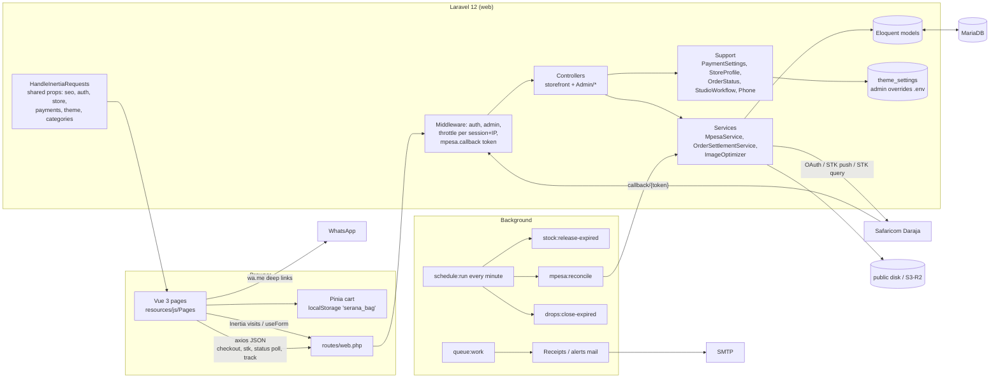
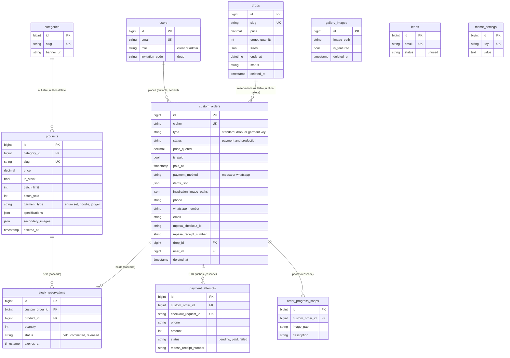
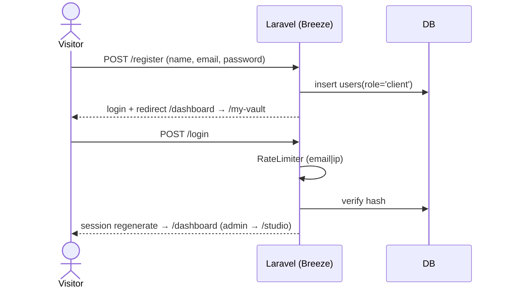
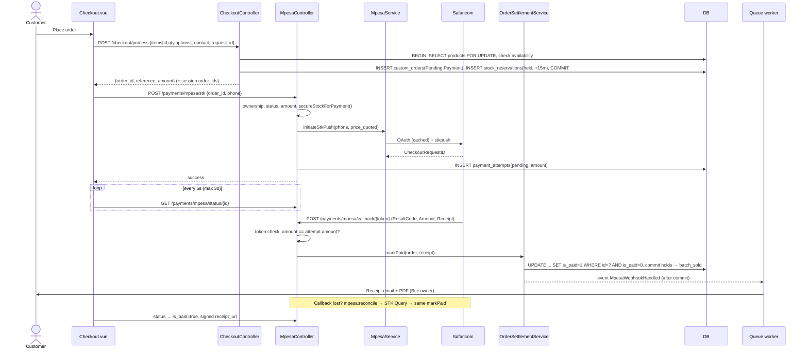
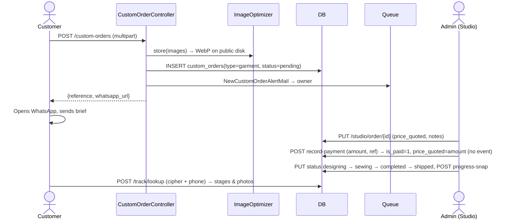
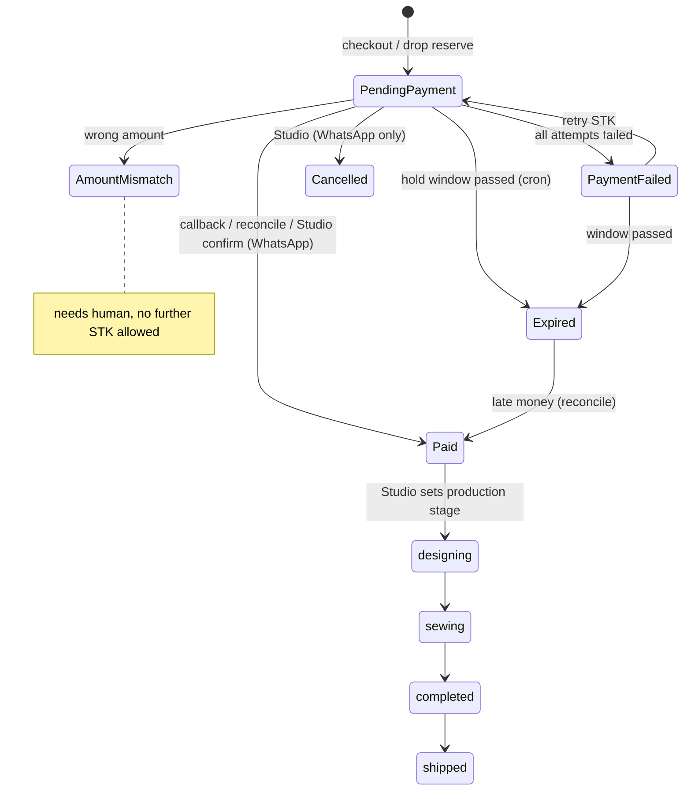

# Serana Closet — Project Understanding

> Snapshot: branch `design/novatek-layout-system` @ `cc88fa4`, 2026-10-19. Read-only review.
> **Updated 2026-10-19** after `hardening/batch-1` (`0bb1dd7` … `5bfb8b7`): risks 3, 7 and 8 resolved, items marked ✅ below. Findings are kept as written, with their resolution noted.
> Evidence key: `path:line`. **[INFERRED]** = deduced, not observed. **[UNKNOWN]** = see Open Questions.
> Line numbers refer to the file at this commit.

---

## 1. Executive summary

Serana Closet is a single-tenant Laravel 12 + Inertia/Vue 3 web shop for a Nairobi clothing studio. It does three things: sells ready-to-wear pieces in limited batches, takes bespoke (made-to-measure) briefs that are quoted and agreed over WhatsApp, and runs "Drops" (sell-then-make pre-orders, switched off for V1 by `DROPS_ENABLED=false`). Money comes in through M-Pesa STK push (Safaricom Daraja) or through "WhatsApp orders" that staff confirm by hand. Every sale is a row in one table, `custom_orders`, whatever its kind. The money path is the most mature part of the code. Prices are set on the server. Every STK push is recorded as a `PaymentAttempt`. Settlement is a single atomic conditional UPDATE shared by the callback, a reconciliation job that runs every minute, and the Studio's manual confirmation. Stock is held per order and expires on a schedule. Customer-facing endpoints check that the order belongs to the caller (via the session, or reference + phone). There are 186 passing feature tests concentrated on this path. The main weaknesses:
- Concurrency has only been tested on SQLite, where row locks do nothing. ✅ *Resolved in `61bcda3`: CI now also runs on MariaDB 11.8 with real multi-process race tests, which found and fixed two lock-order deadlocks.*
- Operations: cron, queue worker, mail DNS and backups are documented but not yet provisioned (`docs/audit/GO-LIVE-CHECK-2026-10-17.md`).
- A few edge paths bypass the shared settlement: bespoke "record payment", and receipts for archived orders.
- One overloaded `status` column carries both the payment and the production lifecycle.

---

## 2. Tech stack & running locally

### Stack (verified from manifests and lockfiles)

| Layer | What | Evidence |
|---|---|---|
| Runtime | PHP ^8.2 (ddev: 8.2, nginx-fpm) | `composer.json`, `.ddev/config.yaml` |
| Framework | Laravel **12.70.0** (README claims 11.x; that is out of date) | `ddev exec php artisan --version` |
| Server↔client glue | inertia-laravel v2.0.24, Ziggy 2 (`@routes` publishes every named route to JS) | `composer.lock`, `resources/views/app.blade.php:60` |
| Frontend | Vue 3.5.44, @inertiajs/vue3 2.3.18, Pinia 3, Vite 7.3.7, Tailwind 3, animejs 4 | `node_modules/*/package.json` |
| DB | MariaDB 11.8 (ddev and production). Tests use SQLite `:memory:` by default, and MariaDB when `DB_CONNECTION=mariadb DB_DATABASE=testing` is set (CI runs both) | `.ddev/config.yaml`, `.env.example`, `phpunit.xml` |
| Queue / cache / session | `database` driver for all three | `.env.example`, `deploy/env.production.example` |
| PDF | barryvdh/laravel-dompdf (receipts) | `app/Http/Controllers/ReceiptController.php` |
| Images | intervention/image 3 (GD), WebP re-encode at upload | `app/Services/ImageOptimizer.php` |
| Storage | `public` disk locally/prod example; S3/R2 supported (`league/flysystem-aws-s3-v3`) | `config/filesystems.php:16-17` |
| CI | GitHub Actions: build, `php artisan test`, `node --test tests/Frontend/` (PHP 8.2, Node 22) | `.github/workflows/ci.yml` |

### Run locally (verified path)

```bash
ddev start                      # web + MariaDB; also runs `schedule:work` and `queue:work` daemons (.ddev/config.yaml)
cp .env.example .env            # only if .env is missing
ddev composer install
ddev exec php artisan key:generate
ddev exec php artisan migrate --seed   # seeders refuse to run outside local/testing (database/seeders/DatabaseSeeder.php:18)
npm ci && npm run dev           # or npm run build
# Tests
ddev exec php artisan test      # SQLite: 203 pass, 5 MariaDB-only concurrency tests skip, ~4s
# Same suite on MariaDB (needs a database whose name contains "test"; tests wipe it):
ddev exec 'mysql -uroot -proot -e "CREATE DATABASE IF NOT EXISTS testing; GRANT ALL ON testing.* TO \"db\"@\"%\""'
ddev exec 'DB_CONNECTION=mariadb DB_DATABASE=testing php artisan test --fail-on-skipped'   # 208 pass
node --test tests/Frontend/     # 21 tests
```

- There is no host PHP. Everything goes through `ddev exec`.
- ddev containers have no outbound DNS (observed: `composer audit` failed to resolve packagist.org). Real STK pushes can't be sent locally, so M-Pesa is exercised with HTTP fakes in the tests.
- Demo admin credentials are in `DatabaseSeeder.php`. The local DB may have been reset since with `php artisan serana:admin <email>` (`app/Console/Commands/SetAdminPassword.php`).

### Entry points

| Kind | Where |
|---|---|
| HTTP | `public/index.php` → `bootstrap/app.php` (web routes, `/up` health, CSRF exempt `payments/mpesa/callback/*`, trusted proxies from `TRUSTED_PROXIES` via `config/trustedproxy.php`, `WarnOnUntrustedForwardedHeaders` appended) |
| Routes | `routes/web.php` (public 21–86, auth 94–110, Studio 118–158), `routes/auth.php` (Breeze) |
| Scheduler | `routes/console.php`: `stock:release-expired` every minute, `mpesa:reconcile` every minute (background, no overlap), heartbeat every minute, `drops:close-expired` every 5 minutes |
| Queue | `SendOrderConfirmation` listener, `NewCustomOrderAlertMail`, `WhatsAppOrderPlacedMail` (all `ShouldQueue`) |
| CLI | `serana:preflight`, `serana:admin`, `mpesa:reconcile`, `stock:release-expired`, `drops:close-expired`, `media:reoptimize`, mail test command (`app/Console/Commands/*`) |
| Frontend | `resources/js/app.js` (Inertia app, Pinia, Ziggy, `v-reveal` directive, idle prefetch of 5 storefront pages) |
| Deploy | `deploy/deploy.sh <tag>` (mysqldump + uploads tar → `down` → checkout tag → composer/npm build → migrate → optimize → `queue:restart` → `up` → `serana:preflight`), `deploy/crontab`, `deploy/supervisor-serana-worker.conf` (2 workers, tries 3) |

### External services & config

| Service | Config | Required? |
|---|---|---|
| Safaricom Daraja (OAuth, STK push, STK query) | `MPESA_*` → `config/services.php` `mpesa` | Optional. Without credentials checkout falls back to WhatsApp only (`app/Support/PaymentSettings.php:59-63`) |
| SMTP mail | `MAIL_*`, `STORE_NOTIFICATION_EMAIL` | Required for receipts and owner alerts (preflight blocker) |
| S3 / Cloudflare R2 | `AWS_*`, `FILESYSTEM_DISK_PUBLIC` | Optional. The code default is `s3` if unset (`config/filesystems.php:17`, register item SC-042) |
| WhatsApp | wa.me deep links only, no API | Number from Studio settings or `WHATSAPP_NUMBER` |

### Git activity

148 commits, 2026-04-05 → 2026-10-18. Most-changed files: `Checkout.vue` (34), `ProductCard.vue` (32), `Shop.vue` (27), `StudioDashboard.vue` (26), `Product.php` (25), `CustomOrder.php` (17), `MpesaController.php` (11). Recent work, from the last 15 commits: payment hardening, WhatsApp ordering, Studio/storefront sync, release tooling, and audit docs.

---

## 3. First principles

### 3.1 The problem, in one sentence

*Let a small Nairobi clothing studio take paid orders for its limited-run pieces and custom tailoring online, by M-Pesa or WhatsApp, without overselling and without losing track of who paid, what to make and where to send it.*

### 3.2 Actors

| Actor | How identified | Can do | Evidence |
|---|---|---|---|
| **Guest shopper** | Browser session; owns orders whose ids are in `session('serana.order_ids')` | Browse, check out (M-Pesa or WhatsApp), trigger STK and poll status **only for own session's orders**, switch own order to WhatsApp, submit bespoke brief, reserve a Drop (when enabled), track any order with **reference + phone**, subscribe to newsletter | `CheckoutController.php:198,220-222`, `MpesaController.php:322-332`, `OrderTrackingController.php:28-58` |
| **Registered client** (`users.role='client'`, the default) | Breeze session auth | Everything a guest can, plus `/my-vault` (own orders, reduced projection) and profile edit/delete. Owner check extends STK/status access to `order.user_id` | `routes/web.php:94-107`, `MpesaController.php:329-331` |
| **Admin** (`role='admin'`) | `admin` middleware: `role === 'admin'` | Everything under `/studio`: orders (fulfilment stages, notes, quotes, record/confirm payment, cancel WhatsApp orders, archive/restore/purge, progress photos), catalogue, categories, gallery, drops, store profile, payment switches, custom-order options, M-Pesa connection test | `app/Http/Middleware/AdminMiddleware.php:18`, `routes/web.php:118-158` |
| **Safaricom** | Secret token in callback URL path (`hash_equals`), plus an optional IP allowlist when `MPESA_ENV=production` | POST STK results | `VerifyMpesaCallback.php:29-47` |
| **Scheduler/worker** | Server process | Expire holds/orders, reconcile payments, close drops, send mail | `routes/console.php` |

The `users.role` comment mentions a `tailor` role (`2026_04_03_153243_add_role_to_users_table.php`). Nothing checks for it, so it doesn't exist in practice. Registration is open, and email verification isn't enforced (`MustVerifyEmail` is commented out in `app/Models/User.php:3`).

### 3.3 Core entities

| Entity | Purpose | Key fields | Relationships | Lifecycle |
|---|---|---|---|---|
| **CustomOrder** (`custom_orders`) — *every* sale | Shop order, bespoke brief, or Drop reservation | `cipher` (public ref `SRN-XXXXXXXX-YYYY`, unique), `type`, `status`, `price_quoted`, `is_paid`, `paid_at`, `payment_method` (`mpesa`/`whatsapp`), `items_json` (server snapshot), contact (`full_name`, `email`, `phone`, `whatsapp_number`, `address`, `city`), measurements, `mpesa_checkout_id` (latest push, legacy), `mpesa_receipt_number`, `internal_notes`, `priority_pass`, `drop_id`, `deleted_at` | belongsTo User, Drop; hasMany StockReservation, PaymentAttempt, OrderProgressSnap | **Payment states:** `Pending Payment` → `Paid` \| `Payment Failed` \| `Amount Mismatch` \| `Expired` \| `Cancelled`. **Production states:** `pending`→`designing`→`sewing`→`completed`→`shipped`. Both share one column (`app/Support/OrderStatus.php:8-31`) |
| `type` values | `standard` = shop checkout; `drop` = Drop reservation; **anything else = bespoke**, set to the garment key the customer picked (`set`/`hoodie`/`jogger`) or `custom` | — | — | `CustomOrderController.php:103`; `StudioWorkflow.php:16` treats `NOT IN (standard, drop)` as bespoke |
| **Product** | Sellable ready-to-wear piece | `price` (decimal, whole KES enforced at write), `in_stock` (manual switch), `batch_limit` (null = unlimited), `batch_sold` (moved only by settlement), `garment_type` enum, `specifications` JSON, images, soft-delete | belongsTo Category; hasMany StockReservation | Live → archived (soft delete) → purged |
| **StockReservation** | Unit hold for an unpaid order | `quantity`, `status` `held`/`committed`/`released`, `expires_at` | belongsTo CustomOrder (cascade), Product (cascade) | `held` → `committed` on payment; `held` → `released` on expiry/failure; `released` → `held` re-acquired on retry, or → `committed` if money arrives late (`CustomOrder.php:130-187`) |
| **PaymentAttempt** | One STK push and its outcome | `checkout_request_id` (unique), `phone`, `amount` (int KES at push time), `status` `pending`/`paid`/`failed`, result code/desc, receipt no. | belongsTo CustomOrder (`withTrashed`) | `pending` → `paid` \| `failed` |
| **Drop** | Sell-then-make campaign | `price`, `target_quantity`, `ends_at`, `sizes` JSON, `status` `draft`/`live`/`greenlit`/`fulfilled`/`closed` | hasMany CustomOrder (`drop_id`) | `live` → `greenlit` (paid ≥ target) or `closed` at deadline (`CloseExpiredDrops.php:22-41`); others set by hand |
| **OrderProgressSnap** | Studio photo shown on tracking | `image_path`, `description` | belongsTo CustomOrder (cascade) | append-only |
| **Category**, **GalleryImage** (The Circle), **Lead** (newsletter email) | Merchandising / marketing | — | Category hasMany Product | Gallery soft-deletes |
| **ThemeSetting** | Key/value store for everything the admin can edit: store profile, payment switches (JSON under `payment_settings`), custom-order options (JSON), theme images/text | `key` unique, `value` text | — | Loaded once per request/job (scoped binding, `AppServiceProvider.php:21`). **Overrides `.env`** (`StoreProfile.php`) |
| **User** | Auth | `role`, `invitation_code` (dead column, register SC-049) | hasMany CustomOrder | Breeze |

### 3.4 Invariants

| # | Invariant | Enforced? | Where / gap |
|---|---|---|---|
| I1 | A shop order's total is the sum of catalogue price × quantity at checkout. The client can't influence the price | **Yes** | Client sends only `id`, `quantity`, `options`. Quantity must be an integer from 1 to 20, and the product must exist and not be deleted (`StoreCheckoutRequest.php:38-43`). Prices are re-read from the DB and items snapshotted (`CheckoutController.php:51-91`). There is **no delivery fee in the code**, yet the WhatsApp message says "(delivery included)" (`WhatsAppOrderMessage.php:29`) |
| I2 | The M-Pesa amount equals `price_quoted`, in whole KES | **Yes** | `MpesaController.php:106-112` refuses fractional or zero amounts. Product prices must be whole (`CatalogController.php:35`). **Drop prices may be fractional** (`Admin/DropController.php:55`), so such a Drop can never be paid. Drops are off for now |
| I3 | A commerce order's total is frozen after checkout | **Yes** for `standard`/`drop` and for any paid order | `StudioController.php:143-146` |
| I4 | An order becomes paid only through settlement, exactly once | **Mostly** | Atomic `UPDATE … WHERE is_paid=0` plus stock commit in one transaction, with the event fired after commit (`OrderSettlementService.php:27-56`). The Studio can't toggle `is_paid` (`StudioController.php:140-142`). **Exception:** bespoke "Record payment" flips `is_paid` directly, fires no event and sends no receipt, and **overwrites `price_quoted` with the amount received** (`StudioController.php:233-239`) |
| I5 | A successful callback must match the amount pushed | **Yes** (callback). **No** (reconciliation) | Callback compares against `attempt.amount` (`MpesaController.php:248-254`). Reconciliation trusts STK Query `ResultCode 0` without checking an amount (`ReconcilePendingPayments.php:61-67`), on the reasoning that the push amount was server-set |
| I6 | A paid order is never downgraded, and an Amount Mismatch isn't hidden by a later failure | **Yes** | `markUnpaid` is conditional on `is_paid=0` and `status != Amount Mismatch` (`OrderSettlementService.php:65-78`) |
| I7 | Stock is never oversold at checkout: `batch_limit − batch_sold − active holds ≥ requested`, summed across size lines | **Yes, tested on MariaDB** ✅ | Pre-check, then re-check inside the transaction with products `lockForUpdate`'d in id order (`CheckoutController.php`). Every stock path now locks in one global order, products by id then `stock_reservations` (`CustomOrder::lockReservedProducts`, `61bcda3`). `ConcurrencyTest` races real processes on MariaDB: two checkouts for the last unit sell it once; checkout vs STK retry and checkout vs settlement neither deadlock nor oversell; a forced deadlock is retried (3 attempts, `2514ead`) with no duplicate order, hold or settlement |
| I8 | `batch_sold ≤ batch_limit` | **No, by design** | Late money commits even `released` holds (`CustomOrder.php:130-141`). Admins can also lower `batch_limit` below `batch_sold`. `availableStock()` floors at 0 (`Product.php:114-121`). There is no DB CHECK constraint |
| I9 | Only the buyer can push or poll an order, and tracking leaks no PII | **Yes** | Session/owner/admin check (`MpesaController.php:322-332`). Tracking needs cipher **and** a normalised phone match, with one generic error for both failures (`OrderTrackingController.php:39-50`). The payload excludes email, address and notes (`CustomOrder.php:214-245`). The receipt is a 7-day signed URL |
| I10 | Payment evidence is never destroyed | **Yes** | Purge is refused when the order is paid or has any attempts (`StudioController.php:326-328`). Settlement and lookups use `withTrashed` and restore the order on payment (`OrderSettlementService.php:32-40`) |
| I11 | Order reference is unique | **DB unique.** Generation is not retried | 32 random bits (`CustomOrder.php:85-87`). A collision would surface as a 500. The odds are negligible at this volume |
| I12 | Abandoned holds return to the pool | **Yes** (needs cron) | `ReleaseExpiredReservations.php:24-55` expires M-Pesa orders after `MPESA_RESERVATION_MINUTES` (15) and WhatsApp orders after `holdHours` (12–72). Orders with a recent prompt are spared |
| I13 | A submission retried after a lost response doesn't create a duplicate | **Yes (per session)** | `request_id` UUID plus a payload hash cached in the session (`app/Support/SubmissionReceipt.php`). A second checkout supersedes the session's earlier abandoned unpaid order (`CheckoutController.php:274-293`) |

### 3.5 The most valuable flow

**Shop checkout → M-Pesa STK → callback/reconcile → receipt → fulfilment.** It is traced in §5.3. The WhatsApp variant (§5.4) is the fallback whenever M-Pesa is unconfigured or paused.

---

## 4. Architecture & data model

### 4.1 Architecture

A monolith with no API layer. Inertia renders server-routed Vue pages. Money and tracking endpoints are JSON called with axios.



Layering is light: controllers hold a lot of logic (e.g. `StudioController::index` builds every Studio dataset). The two services that matter, `OrderSettlementService` and `MpesaService`, are the shared money path.

### 4.2 Data model



Framework tables: `sessions`, `cache`, `jobs`, `failed_jobs`, `password_reset_tokens`.

**Indexes present:**
- `custom_orders`: `cipher` (unique), `status`, `user_id`, `whatsapp_number`, `mpesa_checkout_id`, `(drop_id, is_paid)`, `paid_at`, `payment_method`, `(status, created_at)`
- `payment_attempts`: `checkout_request_id` (unique), `(status, created_at)`
- `stock_reservations`: `(product_id, status, expires_at)`, `(status, expires_at)`

**Gaps and smells:**
- **Redundant indexes:** `products.slug` and `theme_settings.key` are both unique and also plain-indexed (`2026_04_16_000001…`, `2026_04_05_145930…`). That `2026_04_16` migration also `return`s out of the Blueprint closure on the first missing column, silently skipping the later indexes.
- **No uniqueness on `mpesa_receipt_number`** (orders or attempts). A replayed receipt isn't detected at DB level. Only the callback token stands in the way.
- **No CHECK constraints:** quantities, `batch_sold ≤ batch_limit` and status vocabularies are all free strings. `garment_type` is the only enum.
- **Missing index on `custom_orders.email`.** Not important, since Studio search uses leading-wildcard `LIKE`, which can't use an index anyway (`StudioController.php:178-191`).
- **Deliberate denormalisation:**
  - `items_json` snapshots name, price and image per line.
  - `mpesa_checkout_id` and `mpesa_receipt_number` on the order duplicate the latest/paid attempt.
  - Shop orders store the phone twice (`phone` = `whatsapp_number`).
  - Measurements live both in columns and in `items_json.precision_sizing` / `height_cm`.
- **Overloaded columns:** `status` carries two state machines, and `type` mixes order kind with garment type.
- **Dead schema:** `users.invitation_code`, `leads.status`. `Lead::$fillable` lists the non-existent `source` and `is_active` (`app/Models/Lead.php:9`).

---

## 5. Key flows

### 5.1 Signup / login (stock Breeze)

1. `POST /register` creates a `client` user and logs them in (`Auth/RegisteredUserController.php:32-50`).
2. `POST /login` goes through `LoginRequest`, which is rate-limited (5 attempts per email+IP, Breeze default). The session is regenerated, which keeps `serana.order_ids`.
3. `/dashboard` redirects admins to `/studio` and everyone else to `/my-vault` (`routes/web.php:81-86`).
4. Admin accounts are created only by `php artisan serana:admin`. That command enforces at least 12 characters and ends the account's other sessions.



### 5.2 Browse catalogue

- `GET /shop?category=` loads **all** products with category and the active-hold sum in one query (`withAvailability`), plus `available_stock` (`ShopController.php:12-32`). There is no pagination and no server-side search. `sort` is echoed back but never applied on the server, so sorting is client-side **[INFERRED]**.
- `GET /shop/{slug}` uses route-model binding, which hides soft-deleted products.
- Home shows four featured pieces and twelve showcase pieces that still have units left, using a bound `whereRaw` subquery (`HomeController.php:28-31`).
- Every Inertia response carries shared props from `HandleInertiaRequests.php:40-70`: SEO, store profile, payment methods, theme settings and **all categories**.
- Cart: Pinia keeps it in `localStorage['serana_bag']`. It caps quantity client-side by `available_stock`, but the server re-checks everything (`useCartStore.js:13-115`).

### 5.3 Checkout → M-Pesa → confirmation (core money flow)

1. **Checkout form.** `POST /checkout/process` is throttled (20/min per session, 300/min per IP), with `->block(10,10)`.
   - The request is validated: Kenyan mobile number, up to 30 lines, quantities from 1 to 20.
   - `SubmissionReceipt::recall` short-circuits a replayed `request_id`.
   - Earlier abandoned unpaid M-Pesa orders from the same session are expired, and their holds released (`CheckoutController.php:40-45,274-293`).
2. **Re-pricing and snapshot.** This is a pre-check without locks (`CheckoutController.php:51-98`).
3. **Transaction.**
   - Each product is `lockForUpdate`'d in id order, and availability is re-checked.
   - A `CustomOrder` is created with `type=standard`, `status=Pending Payment` and `price_quoted=total`.
   - A `StockReservation(held)` is created for each batch-limited product. It expires after 15 minutes for M-Pesa, or after `holdHours` for WhatsApp (`CheckoutController.php:117-172`).
   - A stock race throws `DomainException`, which returns 422. Anything else is logged and returns 500.
4. **Bind to session.** The order id is pushed onto `serana.order_ids`, and the response carries `order_id`, `reference` and `amount` (`CheckoutController.php:198-211`).
5. **STK push.** `POST /payments/mpesa/stk` (6/min per session), handled by `MpesaController::initiate`. It refuses when:
   - the order isn't the caller's (answers 404);
   - M-Pesa is paused (409 `mpesa_paused`);
   - the order is a WhatsApp order, already paid, expired, a paused Drop, or in Amount Mismatch;
   - the amount is fractional or zero.

   It then calls `secureStockForPayment()`, which extends live holds or re-acquires released ones and refuses if the stock has gone. Next, `MpesaService::initiateStkPush` gets a cached OAuth token and POSTs `processrequest` with a 20s timeout. It records a `PaymentAttempt(pending, amount)`, updates `mpesa_checkout_id`, and conditionally resets the status to Pending Payment (`MpesaController.php:31-178`).
6. **Poll.** The browser GETs `/payments/mpesa/status/{id}` every 5s, 30 times, about 2.5 minutes in total (`Checkout.vue:341`). The endpoint is ownership-checked. Once paid, it returns the signed receipt URL and a "paid" WhatsApp link (`MpesaController.php:281-315`).
7. **Callback.** `POST /payments/mpesa/callback/{token}` is checked by token, then the IP allowlist.
   - The payload is validated, and the attempt is matched by `CheckoutRequestID`, falling back to the order's legacy `mpesa_checkout_id`.
   - **Already paid:** a second success is booked as a duplicate payment (a refund is owed), and Studio's Attention list shows "Paid N times".
   - **Success:** the amount must equal `attempt.amount`, otherwise the order is flagged `Amount Mismatch`, its holds released and the owner emailed. If it matches, `markPaid` runs.
   - **Failure:** the attempt is marked failed. The order is failed (and its holds released) only if no other live attempt exists (`MpesaController.php:188-275`).
8. **Settlement.** `OrderSettlementService::markPaid` runs an atomic claim, restores the order if archived, commits the reservations (`batch_sold += qty`), then fires `MpesaWebhookHandled` after commit. `SendOrderConfirmation` (queued, 3 tries) emails the receipt with the PDF to the customer and Bcc's the owner.
9. **Reconciliation.** Every minute, `mpesa:reconcile` checks up to 4 pending attempts aged between 2 minutes and 24 hours, 13s apart, retrying spike-arrest rejections. It also includes orders already marked Expired. `ResultCode 0` leads to `markPaid`. Codes 1032, 1037, 1025, 1 and 2001 mark the attempt failed. Anything else is retried on the next run (`ReconcilePendingPayments.php`).



### 5.4 WhatsApp order (pay-later) flow

1. Checkout with `payment_method=whatsapp` creates the same order, but with a 12–72 hour hold. The customer is emailed and the owner Bcc'd. The response carries a wa.me link pre-filled with the order text (`CheckoutController.php:192-211`, `WhatsAppOrderMessage.php`).
2. Alternatively, an unpaid M-Pesa order can be switched with `POST /checkout/{order}/whatsapp`. This is refused while a prompt from the last 15 minutes may still be paid (`CheckoutController.php:218-253`).
3. The customer pays by any outside means. A Studio admin then uses **Record payment**. The amount must equal the total exactly. `secureStockForPayment` runs, a note is appended, and `markPaid` is called, so the customer gets a receipt (`StudioController.php:249-286`).
4. Alternatively, the admin cancels (holds released), or the order expires after the hold window.

### 5.5 Bespoke brief

1. `POST /custom-orders` validates garment, fabric and colour against the Studio-managed options (`CustomOrderOptions`), plus measurements and up to 6 files of 10MB (JPG, PNG, WEBP or PDF) (`CustomOrderController.php:46-76`).
2. The images are WebP-optimised to the public disk under UUID names. A `CustomOrder` is created with `type=<garment>` and status `pending` (the DB default). It has no price and no phone normalisation.
3. A WhatsApp brief is built, the owner alert is queued, and a wa.me URL is returned. The brief's reference-image links hard-code `/storage/`, so they break on S3 (`CustomOrderController.php:237-240`).
4. Studio quotes a price, which puts the order in the `payment` queue. The customer pays outside the system, and Studio "records payment". **This bypasses settlement:** no `paid` event, no receipt email, and `price_quoted` is overwritten with the amount received (`StudioController.php:221-241`).
5. Production stages and progress photos follow, and the customer sees them on `/track`.



### 5.6 Fulfilment / status changes (Studio)

- **Queues:** `StudioWorkflow::apply` defines the Studio's work queues: `review`, `quotes`, `payment`, `fulfilment`, `production`, `dispatch` (`StudioWorkflow.php:12-25`). The same definition is used for the counts and for the filtered list, so they can't disagree.
- **Status updates:** `PUT /studio/order/{order}` accepts only production stages as new values. A commerce order (shop or Drop) must be paid before its stage can change (`StudioController.php:131-159`).
- **Archiving:** refused while a prompt is pending, and for paid orders that aren't yet completed or shipped. Purging is refused once there's any payment history.
- **Order list:** paginated 30 per page, with server-side search and filters (`StudioController.php:168-208`).



### 5.7 Admin product & stock management

- Create/update product (`CatalogController.php:25-129`):
  - Validation: a unique name, the slug derived from the name, a whole-KES price, an optional `batch_limit`. `batch_sold` is never accepted from a form.
  - Images are optimised to WebP at max 1600px. Replacing an image deletes the old file.
- Archive is a soft delete: the product disappears from the shop, and checkout's `exists` rule ignores it. Purge deletes the files, and its reservations cascade.
- Stock is never edited directly. It is `batch_limit` minus `batch_sold` (moved only by settlement) minus active holds. The Studio low-stock alert uses the same `withAvailability` figure (`StudioController.php:53,80-86`).
- Caveat: two names that differ only in punctuation slugify the same, and that would hit the slug's unique index as a 500 **[INFERRED]**.

### 5.8 Order tracking & receipts

- **Tracking:** `POST /track/lookup` (10/min per session) does an exact upper-case cipher match, then a normalised phone match. It returns `publicTrackingPayload`, including a 7-day signed receipt URL when paid.
- **Receipts:** `GET /orders/{id}/receipt` uses the `signed` middleware and renders a DomPDF receipt.
  - ~~**Bug:** `ReceiptController::download` uses `CustomOrder::findOrFail`, which excludes soft-deleted rows, so an archived paid order's receipt link returned 404.~~ ✅ Fixed in `0bb1dd7`: the receipt loads `withTrashed()` (still `signed`, still paid-only), covered by `ArchivedOrderPaymentTest`.

### 5.9 Drops (paused)

- `POST /drops/{slug}/reserve` creates `CustomOrder(type=drop, Pending Payment, price=drop.price)` with no stock hold, then uses the same STK path (`DropController.php:49-113`).
- Reservations aren't capped at `target_quantity`, which is a funding goal rather than a limit.
- The deadline job sets `greenlit` or `closed`. **Nothing refunds or notifies reservers of a closed drop.** That's why it's paused (register SC-051–054, open question Q1).

---

## 6. Health assessment

| Area | Rating | Evidence |
|---|---|---|
| **Correctness vs invariants** | **Good** | I1–I3, I5 (callback), I6, I9, I10, I12 and I13 are enforced and tested (e.g. `CheckoutIntegrityTest`, `MpesaPaymentSecurityTest`, `PaymentAttemptTest`, `StockReservationTest`, `ArchivedOrderPaymentTest`). Gaps: I4 (bespoke record-payment bypass), I8 (oversell by design, no constraint) and fractional Drop prices. The archived-receipt 404 is fixed (`0bb1dd7`) |
| **Security** | **Good**, with two items | Admin group is guarded. Customer endpoints are ownership-checked and return 404, not 403. Callback token uses `hash_equals` and fails closed (`VerifyMpesaCallback.php:29`). Throttling is per session and per IP (`AppServiceProvider.php:74-81`). Mass-assignment risk is limited: `CustomOrder` is `$guarded=[]` but always built from validated arrays. Searches escape LIKE wildcards and the one `whereRaw` uses bindings. No `v-html` on user data (only static SVG icons in `SocialLinks.vue:18`). Uploads are MIME-checked and stored under random names. Theme assets exclude SVG. **Items:** (1) ✅ *Resolved in `1f09def`:* `trustProxies(at: '*')` let a client spoof `X-Forwarded-For` past `MPESA_ALLOWED_IPS`. Only `TRUSTED_PROXIES` addresses are trusted now (unset = none). Preflight warns about `*` combined with an allowlist, and requests log forwarded headers from untrusted addresses (`5bfb8b7`). (2) `@routes` publishes every route name, Studio included, to anonymous visitors (low). Also: email verification is off, and receipts are bearer links for 7 days. No secrets are committed (`.env` is ignored; the `.env.example` passkey is Safaricom's public sandbox key) |
| **Data integrity / races** | **Good** (was Needs work) | The design is right: row locks, an atomic claim, idempotent commit, and reservation re-acquire done in validate-then-mutate order. ✅ *Resolved:* the locks used to be exercised only on SQLite. Run on MariaDB, the suspected inversion was a **real** deadlock (`1213`, every run): checkout locks product → inserts reservations, while `secureStockForPayment` (STK retry) **and `commitReservations` (settlement)** locked reservations → product. The second site was not in the original finding. When settlement lost, the shopper's checkout returned a 500. Both now lock products first (`61bcda3`), and checkout and settlement transactions retry deadlocks 3 times (`2514ead`). Still open: an Amount Mismatch releases holds while the customer's money is held (`OrderSettlementService.php:88`) |
| **Error handling & logging** | **Needs work** | Money paths log with context and give customers safe messages. Mail never breaks settlement, and the receipt listener retries. Gaps: no error tracker or alerting; logs only (`daily`, `warning` level in prod). ~~The amount-mismatch alert is a synchronous `Mail::raw` inside the Safaricom callback.~~ ✅ Queued as `AmountMismatchAlertMail` (3 tries, after commit) in `a261f13`. Reconciliation gives up on attempts older than 24 hours with no alert (`ReconcilePendingPayments.php:103-104`). `withExceptions` is empty |
| **Tests** | **Good** for money, **Needs work** elsewhere | 208 PHP tests on MariaDB, 203 on SQLite (5 MariaDB-only concurrency tests skip there), all passing; originally 186. 21 node tests. CI runs the PHP suite on both databases. Strong coverage: checkout integrity, STK auth, callback security, attempts and reconciliation, holds and expiry, archived payments, WhatsApp payments, Studio guards, tracking, SEO, preflight. **Untested:** bespoke receipt behaviour, S3 disk paths, Vue components (no component tests), and the browser flows (only manual Playwright evidence in `docs/audit/verification/`) |
| **Performance** | **Good** now, **Needs work** at scale | Availability is computed in one query (`Product.php:86-89`), settings once per request, and the Studio order list is paginated. Unbounded loads remain: `/shop` loads all products; Studio `index` eagerly loads all products, archived products, gallery, leads, and **every drop with all its reservations** on each visit (`StudioController.php:118-127`, register SC-015 deferred); shared `categories` on every response. About 6.5MB of unreferenced 2MB PNGs sit in `public/images` (not served unless linked) |
| **Maintainability** | **Needs work** | Comments are clear and Support classes centralise the rules. But `status` and `type` are overloaded (`OrderStatus.php:8-15`). There are four copies of the disk-URL resolver (`Category`, `Drop`, `GalleryImage`, `OrderProgressSnap`) next to `PublicUrl`. Controllers are fat (`StudioController::index`). ~~The README is out of date (Laravel 11 / SQLite).~~ ✅ Updated with the stack and ddev steps. Dead fields: `invitation_code`, `Lead` fillable. `optimized_*_url` accessors exist only as aliases. Pint isn't enforced in CI. Dependencies are current (Laravel 12.70, Vite 7, Vue 3.5). `npm audit --omit=dev` reported 0, but nearly all JS deps are devDependencies. Composer audit couldn't run (no DNS) |
| **Deployment readiness** | **Needs work → Critical until done** | Tooling is good: tag-only `deploy.sh` with a pre-deploy mysqldump plus uploads tar, maintenance mode, migrate, `queue:restart`, and a `serana:preflight` that checks env, debug, admin password, mail, M-Pesa live config, scheduler heartbeat, queue backlog and storage link (`ProductionPreflight.php:31-102`). **Not done** (per `GO-LIVE-CHECK-2026-10-17.md`): server, cron, supervisor, mail DNS (SPF/DKIM/DMARC), upload limits, `FILESYSTEM_DISK_PUBLIC` explicitly set, and **`TRUSTED_PROXIES`** set to the Cloudflare/load-balancer ranges if one fronts the app (blank if nginx faces the internet directly). Preflight now warns when requests arrived via an untrusted proxy in the last 24 hours. Backups exist only at deploy time and on the same server, with no scheduled off-box backup and no restore drill |

---

## 7. Synthesis

### 7.1 Complete / half-built / stubbed

| Complete | Half-built | Stubbed / planned / dead |
|---|---|---|
| Catalogue, cart, shop checkout, M-Pesa STK + callback + reconcile, holds and expiry, WhatsApp ordering and Studio confirmation, tracking, PDF receipt and email, Studio order queues and editor, catalogue/gallery/settings admin, SEO (server meta, sitemap, robots), preflight and deploy tooling, CI | Bespoke payments (recorded but no receipt; no deposits), Drops (complete in code, paused for policy), S3/R2 storage (supported, unverified; brief links assume local), refunds (detected as "Paid N times" / Amount Mismatch, but no refund action), Pint/lint in CI | `tailor` role, invitation system (`invitation_code`), `leads.status`/unsubscribe, Stripe/i18n/AI/currency (moved to `docs/deferred-experiments/` as `.txt`), README feature claims ("X-Ray", "Studio Pulse") not checked against UI **[UNKNOWN]** |

### 7.2 Top 10 risks (impact × likelihood)

| # | Risk | Impact | Likelihood | Evidence |
|---|---|---|---|---|
| 1 | Go-live without cron or worker: holds never expire, missed callbacks never settle, receipts never send | Critical | High until provisioned | `routes/console.php`, `deploy/crontab`, `GO-LIVE-CHECK-2026-10-17.md` |
| 2 | No scheduled off-server backup: one disk failure loses every order and payment record | Critical | Medium | `deploy/deploy.sh` backs up only on deploy, to `$HOME/serana-backups` |
| 3 | ✅ **Resolved** (`61bcda3`, `2514ead`). Stock/payment locking was never tested on MariaDB. Confirmed deadlocks: checkout vs STK retry, and checkout vs settlement. Fixed with one global lock order plus 3-attempt retries, guarded by `ConcurrencyTest` in CI | ~~High~~ | ~~Medium~~ | `CustomOrder::lockReservedProducts`, `tests/Feature/ConcurrencyTest.php` |
| 4 | Bespoke "Record payment" bypasses settlement: no receipt, quote overwritten, so deposits or part-payments corrupt the order total | High | High (every bespoke order) | `StudioController.php:221-241` |
| 5 | Late or duplicate money with stock gone: `batch_sold` can exceed `batch_limit` and refunds are handled by hand | High | Low–Medium | `CustomOrder.php:130-141`, `StudioController.php:89-99` |
| 6 | Amount Mismatch releases the customer's held units while their money sits in the till | Medium | Low | `OrderSettlementService.php:86-88` |
| 7 | ✅ **Resolved** (`0bb1dd7`). Archived paid orders: the receipt link from tracking returned 404 | ~~Medium~~ | ~~Medium~~ | `ReceiptController.php` |
| 8 | ✅ **Resolved** (`1f09def`, `5bfb8b7`). `trustProxies('*')` made the M-Pesa IP allowlist spoofable. Now only `TRUSTED_PROXIES` addresses are trusted. **Go-live action:** set it if a CDN or load balancer fronts the app | ~~High~~ | ~~Low~~ | `config/trustedproxy.php`, `WarnOnUntrustedForwardedHeaders` |
| 9 | Studio dashboard payload grows with catalogue, gallery, leads and drop reservations, slowing the Studio | Medium | Medium over months | `StudioController.php:118-127` |
| 10 | Overloaded `status`/`type` columns: every new feature risks mixing payment and production states (it already needed special cases in `StudioWorkflow`, `update`, `recordPayment`) | Medium | Medium | `OrderStatus.php:8-15`, `CustomOrderController.php:103` |

### 7.3 Recommended next steps (each unblocks the next)

1. ✅ Done (`0bb1dd7`): `ReceiptController` loads orders `withTrashed()` (risk 7).
2. ✅ Done (`1f09def`, `5bfb8b7`): trusted proxies come from `TRUSTED_PROXIES`, with a preflight warning and a runtime warning (risk 8).
3. ✅ Done (`61bcda3`, `2514ead`): the PHP suite runs on MariaDB in CI, with race tests. Both lock-order inversions (STK retry and settlement) fixed, and deadlocks retried (risk 3).
4. **Provision production per `deploy/`:** cron, supervisor, explicit `FILESYSTEM_DISK_PUBLIC`, `TRUSTED_PROXIES` (Cloudflare/load-balancer ranges, or blank), mail DNS, PHP/nginx upload limits. Done when `serana:preflight` is green (risk 1).
5. **Scheduled off-box backups** of the DB and uploads, with one restore drill written down (risk 2).
6. **Owner decides the bespoke payment rules** (deposit? balance? receipt?). Then route bespoke payments through `OrderSettlementService`, or through a small payments ledger that stores amounts received without overwriting `price_quoted` (risk 4; needs Q2).
7. **Owner decides the Amount Mismatch and late-payment stock policy.** Then keep holds on mismatch and add an explicit Studio refund/resolve action that records the outcome (risks 5–6; needs Q3).
8. **Add error alerting** (an error tracker or a log alert) on `Checkout_Fault`, amount mismatch, reconciliation giving up after 24h, and failed jobs. (The mismatch email is already queued: `a261f13`.)
9. **Lazy-load or paginate the Studio tabs** (products, gallery, leads, drops and reservations) as Inertia lazy props, the way orders already are (risk 9, SC-015).
10. **Split `status`** into `payment_status` and `fulfilment_status`, and `type` into `kind` + `garment`, with a backfill migration and the constants in `OrderStatus`. Do it after steps 3 and 6, so the tests guard the money path through the refactor (risk 10).

Also: add Pint to CI. (README refreshed.)

### 7.4 Open questions for the owner

1. **Drops:** what happens to paid reservations when a drop closes unfunded: automatic refund, store credit, or a manual call? This blocks `DROPS_ENABLED`.
2. **Bespoke money:** do you take deposits? Should "Record payment" mean paid in full, and should bespoke customers get the same emailed receipt?
3. **Late or duplicate M-Pesa payments:** when money arrives after the piece sold to someone else, or a customer pays twice, what's the refund process and who does it? Should the system record refunds?
4. **Delivery:** the WhatsApp text says "delivery included". Is delivery always free, and is the delivery area limited (Nairobi only)? The code has no fee or zone logic.
5. **Hold lengths:** are 15 minutes (M-Pesa) and 48 hours by default (WhatsApp) right, given limited batches can be locked by unpaid WhatsApp orders for days?
6. **Accounts:** is open customer registration wanted, and should emails be verified? Is a `tailor`/staff role (non-owner Studio access) needed?
7. **Data retention:** how long should customer measurements, addresses and inspiration photos (publicly reachable by URL on the public disk) be kept?
8. **Storage and hosting:** is production on local disk or R2, and which host and proxy will front it? This decides `TRUSTED_PROXIES` and affects the brief image links.
9. **README claims:** are "X-Ray" overlays, "Studio Pulse" and the "Registry" still intended features? I didn't find them as distinct backend features **[UNKNOWN]**.

---

## 8. Glossary

| Term | Meaning in this codebase |
|---|---|
| **Cipher / reference / order code** | Public order id `SRN-XXXXXXXX-YYYY` (`CustomOrder.php:85-87`). Used with the phone number for tracking |
| **Studio** | The admin dashboard at `/studio` (`Admin/StudioDashboard.vue`) |
| **Shop / standard order** | `custom_orders.type='standard'`: a ready-to-wear checkout |
| **Bespoke / custom order / brief** | Made-to-measure request (`type` = garment key or `custom`). The "brief" is the WhatsApp message the customer sends |
| **Drop** | Sell-then-make campaign. **Greenlit** = funded at the deadline. **Closed** = missed its target |
| **Batch limit / batch sold** | A product's run size and units sold. Availability = limit − sold − active holds |
| **Hold / reservation** | `StockReservation` with status `held` that keeps units for an unpaid order until `expires_at` |
| **STK push / Lipa na M-Pesa Express** | Safaricom prompt on the customer's phone to enter their M-Pesa PIN |
| **Daraja** | Safaricom's M-Pesa API (OAuth, `stkpush`, `stkpushquery`) |
| **CheckoutRequestID** | Daraja's id for one STK push. Unique key of `PaymentAttempt` |
| **Payment attempt** | One STK push and its outcome. An order may have many |
| **Reconcile** | `mpesa:reconcile`: asks Daraja for the outcome of pushes whose callback never came |
| **Spike arrest** | Daraja's rate-limit rejection (`SpikeArrestViolation`). The reconciler spaces queries 13s apart |
| **Settlement** | `OrderSettlementService::markPaid`/`markUnpaid`: the single place that changes payment state |
| **Amount Mismatch** | Paid amount ≠ pushed amount. Order flagged for a human; no more prompts allowed |
| **WhatsApp order** | `payment_method='whatsapp'`: the order is recorded and held, paid outside the system, and confirmed in the Studio |
| **Supersede** | A new checkout expires the same session's older abandoned unpaid order |
| **request_id / SubmissionReceipt** | Client UUID that makes form submissions idempotent within a session |
| **Store profile** | Name, contacts and socials from `theme_settings`, overriding `.env` (`StoreProfile`) |
| **Payment settings** | Studio toggles for M-Pesa and WhatsApp, payment instructions and hold hours (`PaymentSettings`) |
| **Priority Pass** | Flag on a bespoke brief requesting expedited work |
| **The Circle** | Public gallery of client photos and testimonials (`/the-circle`, `GalleryImage`) |
| **Vault / My Vault** | Logged-in customer's order list (`/my-vault`) |
| **Progress snap** | Studio photo of work in progress, shown on tracking |
| **Preflight** | `php artisan serana:preflight`: production readiness checklist. Exits non-zero on blockers |
| **Heartbeat** | Cache key written every minute by the scheduler. Preflight uses it to prove cron runs |
| **Archive / purge** | Soft delete / permanent delete (purge refused once there's payment history) |
