# Batch 2 Design: Ledger, Deposits, Refunds, Delivery, Physical Shop (POS)

> Status: **APPROVED 2026-10-19** with these owner decisions:
> - **D3** (card payments), **D6** (eTIMS) and **D17** (VAT) are set aside for later. Nothing is built for them: no card-terminal flow, no `fiscal_documents`, no `tax_amount`. `card` stays a ledger method name only.
> - **D5:** delivery options are fully Studio-managed and dynamic. No zones or fees are hard-coded. Only "Shop pickup (free)" and "Quote on WhatsApp" are seeded; the owner creates every zone, fee and free-over threshold.
> - **All other decisions** (D1, D2, D4, D7–D16) are approved as recommended.
> Base: `hardening/batch-1` @ `2cbf88f` (PR #1, still open, not merged into `master`). Reference: `docs/PROJECT_UNDERSTANDING.md`.
> Conventions: all money is **whole KES as integers**. "Setting" means a Studio-editable default, never a hard-coded rule. `[CHALLENGE]` marks a place where I recommend a different approach from the brief, with the reason.

---

## 0. Summary

One order model, one stock pool and one money ledger serve every channel: the website, WhatsApp, and the physical shop.

- **Money:** every shilling in or out is an append-only **ledger row**. Payment status is *computed* from the ledger and stored only so it can be queried.
- **Totals:** an order's total is the sum of append-only **order lines** (items, delivery, discounts, adjustments). Corrections are new lines, never edits.
- **Stock:** stock becomes per-size **variants** with an append-only **movement history**. "A unit can be sold once" is enforced by a non-negative on-hand count under the global lock order.
- **Shop:** the POS is just another client of the same services (`OrderSettlementService`, `StockService`), plus till sessions for cash accountability.

Phases (§8): **A** ledger + status split → **B** deposits, pay link, receipts → **C** refunds and resolution → **D** delivery → **E** POS (E1–E5). I recommend pulling **roles + audit log** forward into Phase A, because B and C already need "owner/manager only" actions.

---

## 1. First principles and invariants

### 1.1 Principles

1. **The ledger is the truth about money.** No code path may write `is_paid`, `payment_status`, `amount_paid` or `balance_due` except by appending a ledger row through `OrderSettlementService`, which then recomputes them in the same transaction.
2. **Lines are the truth about what is owed.** Total = Σ order lines. A fixed total is changed only by appending an adjustment line, with an actor and a reason.
3. **Movements are the truth about stock.** On-hand = Σ stock movements per variant. Holds reserve units against on-hand.
4. **One pool, one ledger, every channel.** A shop sale, a WhatsApp order and a web checkout are all orders, settled by the same services. Channel is an attribute, not a separate system.
5. **Append-only for anything financial or stock-related.** No hard deletes. Mistakes are reversed by an opposite entry.
6. **Every money, stock or permission-sensitive action has an actor** (a user, `system` or `safaricom`). Human actions also carry a reason.
7. **Side effects after commit.** Events, mail and WhatsApp links are produced only after the transaction commits, so a retried transaction (3 attempts, batch-1 item 5) leaves no trace.
8. **Global lock order:** products/variants by id → stock holds → order row → ledger rows → till session. A path that needs a later lock never waits for an earlier one while holding a later one.
9. **Policy numbers are settings:** deposit %, hold windows, the 3-day resolution window, the 2-working-day refund promise, the discount limit, delivery fees and so on (full list in §2.4).

### 1.2 Invariants

Status key: **=** unchanged, **Δ** changed, **+** new.

| # | Invariant | Status | Why it changes / how it's enforced |
|---|---|---|---|
| I1 | The total is computed by the server; the client can't influence prices | **Δ** | Total = Σ order lines: items (catalogue price snapshot), delivery fee (computed from the chosen option), discounts (permission-checked), adjustments. Still server-only |
| I2 | An STK amount is chosen by the server, in whole KES | **Δ** | It used to equal `price_quoted`. Now it is either `deposit_due` or `balance_due`, picked by the server from a client *choice* (`deposit`/`balance`), never a client amount |
| I3 | A fixed total isn't silently edited | **Δ** | It used to be a frozen `price_quoted`. Now lines are append-only, and changes are adjustment lines with an actor and a reason |
| I4 | Payment state changes only through settlement | **Δ** stronger | The bespoke "Record payment" bypass (`StudioController.php:233`) is removed. Ledger rows are written only by `OrderSettlementService` |
| I5 | A callback amount is checked against the push | **Δ** | Instead of "mismatch → flag", the amount is classified against the attempt and the balance: exact, over (refund the excess) or under (treat as deposit). Nothing paid is ever dropped. Reconciliation still gets no amount from STK Query, so it books the attempt's amount (unchanged assumption, noted) |
| I6 | Paid state is never downgraded by a direct write | **Δ** | `payment_status` is derived. `paid → refund_due → refunded` is legitimate, but only through ledger rows |
| I7 | Stock is never oversold | **Δ** wider | Applies to every channel. available = on_hand − active holds ≥ requested, re-checked under lock. Tested on MariaDB (`ConcurrencyTest`) |
| I8 | `batch_sold ≤ batch_limit` | **Δ now enforced** | It used to be violated by design: late money committed released holds. Now late money with stock gone → `needs_resolution`, never an overshoot (§4.3). The test `PaymentAttemptTest::test_reconciliation_settles_expired_orders_with_pending_attempts` is updated deliberately, not deleted. Later replaced by I-N6 |
| I9 | Only the buyer acts on their order, and tracking leaks no PII | **Δ** wider | A signed `/pay/{order}` link grants ownership for the STK endpoints. POS staff act through authenticated, permission-checked sessions |
| I10 | Payment evidence is never destroyed | **Δ** wider | Applies to all ledger, stock, cash and audit rows. Purging an order is refused once any of them exist |
| I11 | The public order reference is unique | **=** | Plus: receipt numbers are unique and sequential per series (§2.2) |
| I12 | Abandoned holds return to the pool | **=** (+POS) | POS holds expire after `pos_hold_minutes` too |
| I13 | Resubmission creates no duplicates | **Δ** wider | Plus ledger idempotency: unique `(method, external_reference)` and unique `payment_attempt_id` on ledger rows, so a replayed callback or reconcile can't book twice |
| N1 | amount_paid = Σ payments − Σ refunds; balance_due = chargeable_total − amount_paid | **+** | Stored copies are recomputed in the same transaction as every ledger write. A verify command and a property test prove stored = derived |
| N2 | Σ refunds ≤ Σ payments per order | **+** | Checked under the order-row lock before a refund row is written |
| N3 | Every ledger, stock, cash and audit row has an actor and a timestamp; human actions have a reason | **+** | NOT NULL columns. Validation requires a reason for human actors |
| N4 | An external reference (M-Pesa code, card ref) is booked once per method | **+** | Unique index `(method, external_reference)` where the reference is not null |
| N5 | Every cash movement belongs to an open till session, and expected cash = float + cash in − cash out | **+** | FK + "open session required" check. Variance is recorded at close |
| N6 | A unit is sold once anywhere: on_hand ≥ 0 per variant | **+** | `on_hand` is maintained under the variant lock, with a DB CHECK (≥ 0) |
| N7 | Fulfilment guards | **+** | → `designing` needs `deposit_paid` or `paid`. → `shipped`/`collected` needs balance_due = 0, unless an owner override with a reason (audited) |
| N8 | A deposit is refundable before `designing` and non-refundable after | **+** | Cancellation appends a "retained deposit" line, so chargeable_total = the retained amount. The text comes from a setting and appears on the quote, pay page and receipt |
| N9 | Lock order: products/variants → holds → order → ledger → till | **+** | All services go through `StockService::lock()` / `OrderSettlementService::lockOrder()`. Batch-1's `ConcurrencyTest` is extended. **Note:** today `markPaid` claims the order row *before* locking products (`OrderSettlementService.php`), which is the order the brief forbids. Phase A reorders it |
| N10 | Side effects after commit | **+** | Mail/events use `afterCommit` or are dispatched after `DB::transaction` returns |
| N11 | Permissions are enforced on the server for every Studio/POS action | **+** | Laravel Gates/Policies on every route. UI hiding is cosmetic only |

---

## 2. Data model

### 2.1 ER diagram

The table name `custom_orders` is kept, to avoid touching every query and FK. `[CHALLENGE]` A rename to `orders` adds risk for no behavioural gain. The model can be aliased as `Order` later.

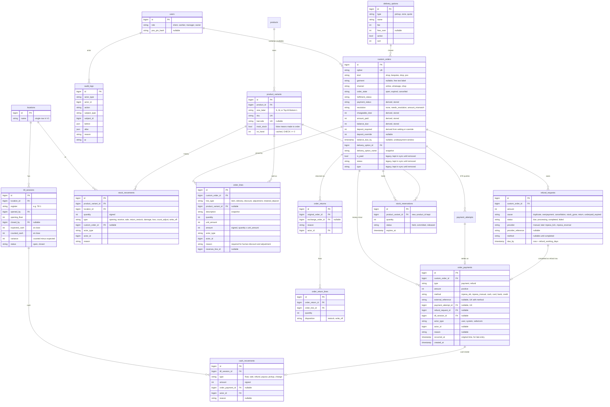

`fiscal_documents` (for eTIMS, §7 D6) is designed but **not built**:

```
order_id, type (invoice|credit_note), status, cu_serial, cu_invoice_number, qr, raw_response.
```

### 2.2 Notable design choices

- **`payment_status` vs `resolution` `[CHALLENGE]`.** The brief puts `needs_resolution` and `amount_mismatch` in `payment_status`. They are orthogonal to money: an order can be `deposit_paid` *and* need resolution. I store a numeric status (`unpaid`, `deposit_paid`, `paid`, `refund_due`, `refunded`) plus a separate `resolution` column. The stored **`payment_status` follows the brief's vocabulary**, by precedence: resolution if set, otherwise the numeric status. So queries and UI badges use one column, and the numbers stay derivable. Owner decision D1.
- **`amount_mismatch` in new flows.** Under the new rules, over- and underpayments are classified automatically (refund_due / deposit_paid). So `amount_mismatch` is produced **only** by the backfill, for the legacy rows where the actual amount paid was never stored (it was only logged; locally there are 6 such orders). It is also produced when a payment can't be classified, for example a callback for an order whose lines have been cancelled. The Studio resolves it by recording what the M-Pesa statement shows.
- **`chargeable_total`** = Σ lines. Cancelling appends reversing lines, so a cancelled order's chargeable_total is 0, or the retained deposit after `designing` (N8). `refund_due` then simply means amount_paid > chargeable_total. Every refund cause reduces to the same arithmetic.
- **Refund design for a later B2C plug-in.** A `refund_requests` row is the obligation; an `order_payments` refund row is the money actually leaving. "Mark refunded" (manual provider) completes the request and writes the ledger row. A future Safaricom B2C/reversal provider would set `provider=mpesa_b2c` and drive `processing → completed/failed` from its callback through the same `OrderSettlementService::completeRefund()`. Nothing else changes.
- **Receipt numbers:** per-series sequences, e.g. `SRN-R-000123` for web and `SHOP-000045` for POS, allocated inside the settlement transaction from a locked counter row. Each ledger payment and refund gets one.
- **`occurred_at` vs `created_at`** supports permission-gated late entry from the offline fallback (§6, D9).
- **`credit` method:** an internal tender used only for exchanges. A return issues credit and the new sale consumes it in the same transaction, so the pair nets to zero.
- **`location_id` from day one** (one row) is cheap future-proofing for a second shop (D2).

### 2.3 Migration and backfill plan

Every migration is **additive and reversible**. The legacy columns (`status`, `type`, `is_paid`, `price_quoted`, `mpesa_*`) stay and are **dual-written** until a later cutover phase, so rollback is always possible.

| Step | Migration | Backfill / mapping | Rollback |
|---|---|---|---|
| A1 | Create `order_lines`, `order_payments`, `refund_requests`, `audit_logs`, `locations`. Add `kind`, `garment`, `channel`, `order_state`, `fulfilment_status`, `payment_status`, `resolution`, money columns to `custom_orders` | None (schema only) | `down()` drops them. No legacy column touched |
| A2 | `serana:ledger:backfill` (idempotent command, run inside the migration and runnable again) | See the mapping table below | Truncate the new tables and null the new columns (`down()`). The legacy columns were never modified |
| A3 | Writes: `OrderSettlementService` writes ledger + new columns **and** keeps the legacy columns in sync | — | Revert the commit; legacy columns are still correct |
| A4 | Reads cut over (Studio queues, tracking, receipts, preflight, Attention) behind `LEDGER_READS=true` | `serana:ledger:verify` must report 0 differences on a production copy first | Set `LEDGER_READS=false` |
| A5 (later, separate PR) | Stop writing `is_paid`/`status`/`type`, then drop them | Only after a release cycle with 0 verify differences | Restore from backup (one-way; called out in that PR) |

**Backfill mapping** (covers every combination present in the local data):

| Legacy | New |
|---|---|
| `type='standard'` | `kind=shop` |
| `type='drop'` | `kind=drop` |
| any other `type` (e.g. `Hoodie & Jogger Set`, `Gown`, `Corporate`, `custom`) | `kind=bespoke`. `garment = type`, or null when `custom`. *Note: these are stored labels, not keys* |
| `payment_method='whatsapp'` | `channel=whatsapp`, otherwise `online` |
| `status='Expired'` | `order_state=expired` |
| `status='Cancelled'` | `order_state=cancelled` |
| any other status | `order_state=open` |
| `status ∈ {pending, designing, sewing, completed, shipped}` | `fulfilment_status = status` |
| `status ∈ {Paid, Pending Payment, Payment Failed, Amount Mismatch, Expired, Cancelled}` | `fulfilment_status=pending` |
| shop order `items_json` lines | one `item` line each (snapshot price × qty). If Σ ≠ `price_quoted`, add an `adjustment` line "backfill difference" and log it for review |
| drop order | one `item` line = `price_quoted` |
| bespoke with `price_quoted > 0` | one `item` line "Bespoke quote" = `price_quoted` |
| bespoke with `price_quoted = 0` | no lines (awaiting quote) |
| each `payment_attempts` row with `status=paid` | `order_payments(payment, mpesa_stk, amount=attempt.amount, ref=attempt receipt, payment_attempt_id, actor=safaricom)`. Two paid attempts produce two rows, so `refund_due` appears automatically. That's correct: the Studio already shows these as "refund owed" |
| `is_paid=1` with no paid attempt (WhatsApp confirmations, bespoke "record payment", pre-attempt M-Pesa) | one `order_payments(payment, mpesa_manual, amount=price_quoted, ref=mpesa_receipt_number or "legacy-{id}", actor=system, reason="backfill: is_paid")`. *The bespoke quotes that "record payment" overwrote can't be recovered. These rows are listed for owner review* |
| `status='Amount Mismatch'` | no ledger row (the amount paid is unknown). `resolution=amount_mismatch`. Shown in Attention, resolved by recording the statement amount |
| derived columns | recomputed by the same `recompute()` the service uses. `is_paid` is re-derived and must equal the legacy value; any difference is reported |

**Tests for the backfill:**
- a fixture of one row per combination above, with its expected mapping;
- a round-trip test: backfill, then `down()`, then the schema and legacy data are unchanged;
- `serana:ledger:verify`: legacy vs derived comparison for every row, exiting non-zero on any difference.

### 2.4 New settings (Studio → Settings, all defaults)

| Setting | Default |
|---|---|
| `deposit_percent` | 50 |
| `refund_working_days` | 2 |
| `resolution_auto_refund_days` | 3 |
| `underpayment_hold_hours` | 24 |
| `pay_link_days` | 14 |
| `pos_hold_minutes` | 30 |
| `cashier_discount_limit` | % and KES caps, see D4 |
| `till_variance_alert` | KES 200 |
| receipt footer | text |
| deposit policy text | "Deposit refundable until work starts (designing); non-refundable after." |
| delivery options | table (D5) |

---

## 3. State machines

Transitions are caused only by the actors and events named on them.

### 3.1 payment_status (derived from ledger, lines and resolution)

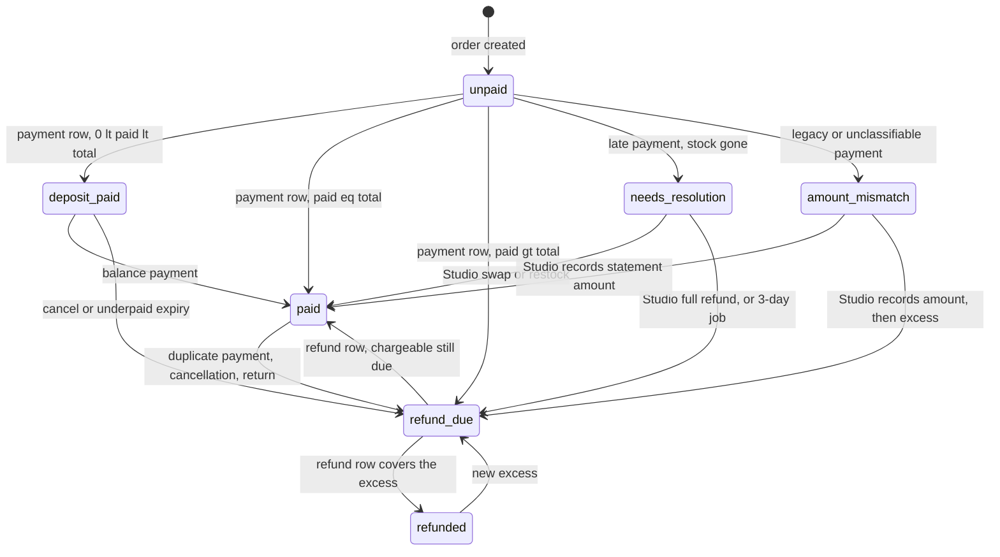

Actors and events:
- payment rows: `safaricom` (callback), `system` (reconcile), staff (`mpesa_manual`/cash/card/bank via POS or Studio);
- refund rows: owner/manager (Mark refunded), or later a B2C callback;
- cancellation and return lines: owner/manager, or cashier with approval for POS returns;
- the 3-day job: `system`.

### 3.2 order_state

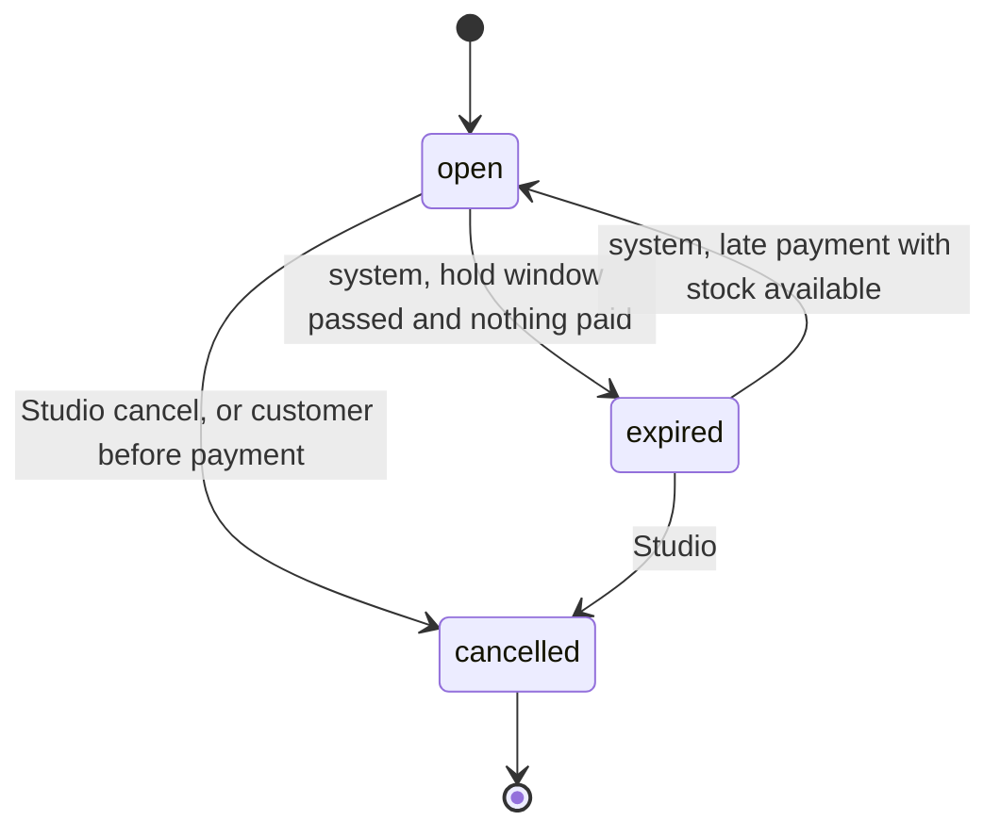

Rules:
- An order with money on it never becomes `expired`. Underpaid expiry instead appends a cancellation, giving `cancelled` + `refund_due` (§4 C, underpayment).
- `expired → open` happens only on a settled late payment while stock is still free.

### 3.3 fulfilment_status

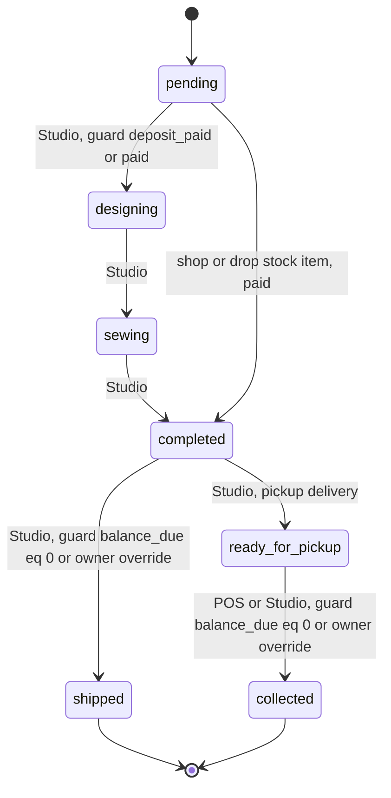

- POS sales go straight to `collected` when fully paid.
- Every override records the owner, the reason and the before/after values in `audit_logs`.

---

## 4. Sequence diagrams

### 4.1 Bespoke: deposit → balance → receipts

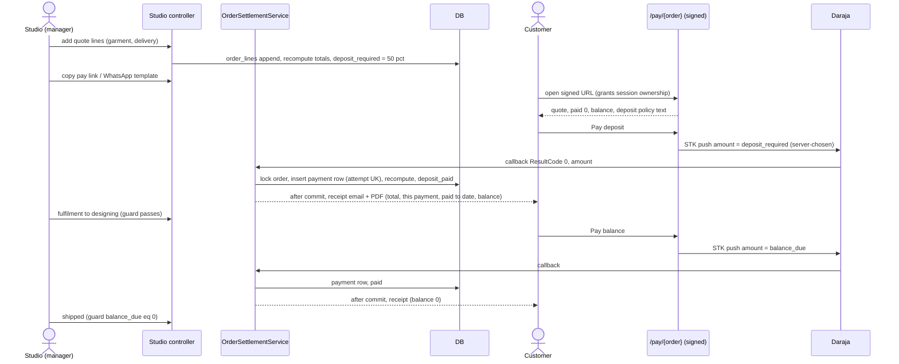

### 4.2 Duplicate payment → refund

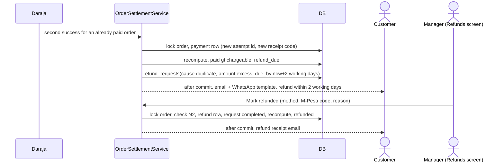

### 4.3 Late payment with stock gone → resolution

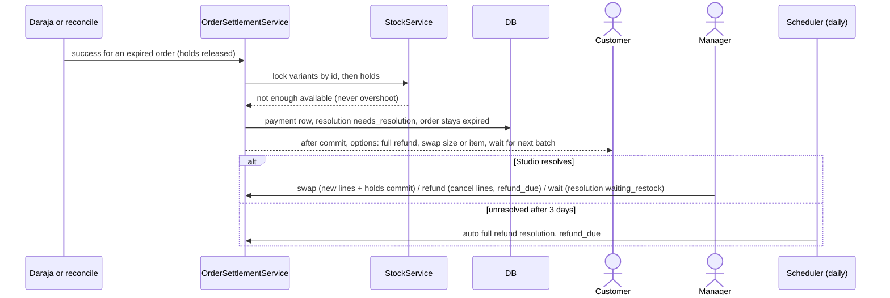

### 4.4 Online checkout with delivery

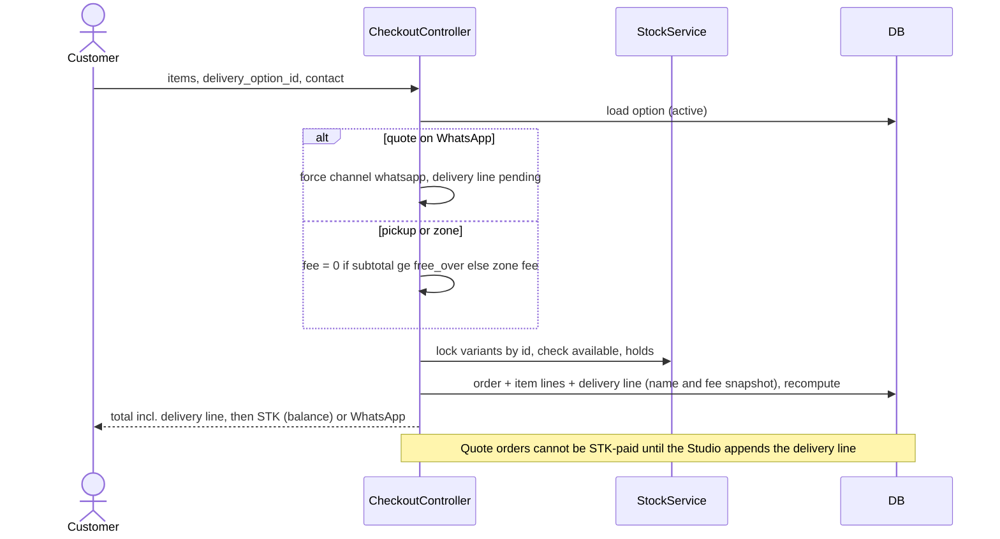

### 4.5 POS split-payment sale

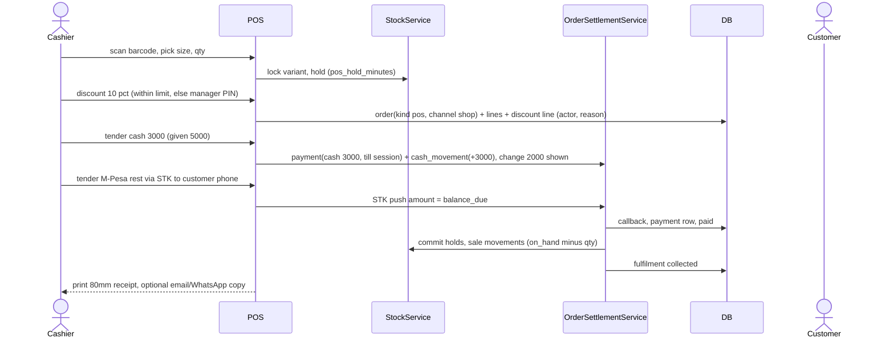

### 4.6 POS return / exchange

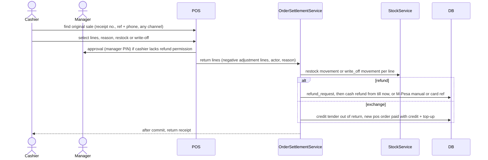

### 4.7 Click & collect

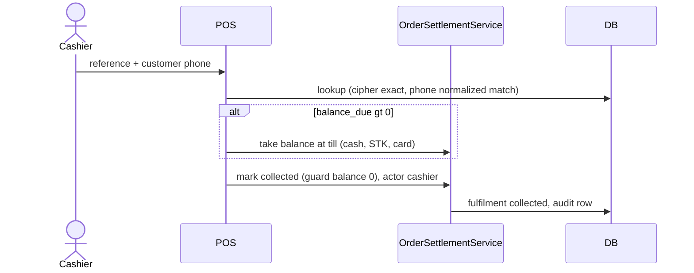

### 4.8 Till open / close

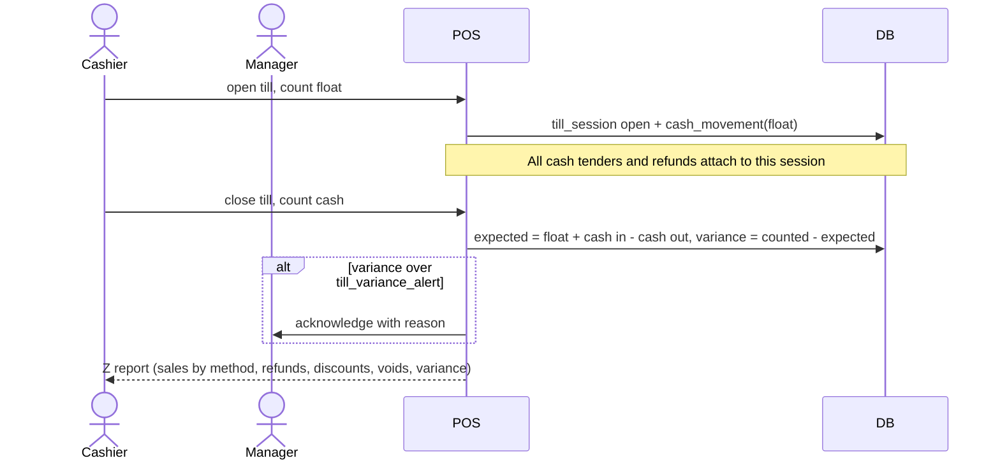

---

## 5. Permission matrix

These are server-side Gates (N11). The Studio and POS hide what you can't do, but the server decides.

| Action | Owner | Manager | Cashier | Client | System/Safaricom |
|---|---|---|---|---|---|
| Studio access (full) | ✓ | ✓ (no Settings → Payments/roles) | ✗ (POS only) | ✗ | — |
| POS sell | ✓ | ✓ | ✓ | ✗ | — |
| Discount within `cashier_discount_limit` | ✓ | ✓ | ✓ | ✗ | — |
| Discount above the limit | ✓ | ✓ | manager PIN | ✗ | — |
| Void an open (unpaid) sale | ✓ | ✓ | own sale only | ✗ | — |
| Void a paid sale / return / refund | ✓ | ✓ | manager PIN | ✗ | — |
| Mark refunded (Refunds screen) | ✓ | ✓ | ✗ | ✗ | B2C later |
| Record payment (manual methods) | ✓ | ✓ | at till only | ✗ | payments: safaricom/system |
| Edit quote / delivery line / deposit override | ✓ | ✓ | ✗ | ✗ | — |
| Fulfilment override (ship/collect with a balance) | ✓ | ✗ | ✗ | ✗ | — |
| Adjust stock (receive, count, damage) | ✓ | ✓ | receive only | ✗ | — |
| Open/close till | ✓ | ✓ | ✓ | ✗ | — |
| Acknowledge till variance | ✓ | ✓ | ✗ | ✗ | — |
| Reports (day, session, sales) | ✓ | ✓ | own session Z | ✗ | — |
| Click & collect | ✓ | ✓ | ✓ | ✗ | — |
| Manage staff and roles | ✓ | ✗ | ✗ | ✗ | — |
| Settings (payments, policies, delivery) | ✓ | delivery only | ✗ | ✗ | — |
| Own orders / pay link / tracking | — | — | — | ✓ | — |

`[CHALLENGE]` The brief lists "refund" as a cashier permission. I recommend cashiers **never** refund on their own: they use a **manager PIN approval overlay** on the same screen. That keeps the counter fast while putting a second person on every money-out.

---

## 6. POS screens (tablet, landscape-first, large touch targets)

Design rules:
- One-handed thumb reach.
- No modal stacks deeper than one.
- Every common action within 2 taps.
- A barcode scanner works as a keyboard anywhere on the Sell screen (a focus trap on a hidden input).
- Big numeric keypads for money and PINs.

1. **Lock / staff switch:** staff tiles, then a 4–6 digit PIN. This is a fast switch on a shared tablet; each staff member still has their own account. It auto-locks after N minutes idle.
2. **Open till:** count the float by denomination (KES 1000/500/200/100/50 notes and coins), then confirm.
3. **Sell (home):**
   - Left 60%: search box (name, SKU, barcode) and a product grid with photo, price and stock per size.
   - Right 40%: the cart (lines, size chips, qty ±, line discount), totals (subtotal, discount, total) and a large **Charge** button.
   - Top bar: till status, staff, an "Orders" button.
4. **Size picker sheet:** opens when a product with variants is tapped. Size chips are greyed when out of stock and show on-hand.
5. **Tender:**
   - Shows balance due.
   - Method buttons: Cash, M-Pesa prompt, M-Pesa code, Card, Credit (exchanges only).
   - Cash shows a keypad with quick amounts (exact, 1000, 2000, 5000) and change shown huge.
   - M-Pesa prompt asks for the phone, then shows live status.
   - Split payments stack as tender chips, each removable before completion.
6. **Receipt:** prints automatically to the 80mm printer (browser print CSS), with Email/WhatsApp copy buttons and a New sale button.
7. **Orders:** search by receipt no., reference + phone, or customer. Tabs: Today, Collect, Returns.
8. **Click & collect:** order summary, a balance badge, a "Take balance" button, then a big **Mark collected** button.
9. **Return / exchange wizard:** pick lines → reason → restock/write-off → refund method or exchange → manager PIN if needed.
10. **Bespoke intake:** customer details, garment, fabric/colour (from Studio options), a measurement form with the sizing figure, a camera capture of references, a quote with a delivery line, and the deposit tender.
11. **Stock:** receive (scan to increment, then confirm), count (scan or enter per variant, showing the difference), damage/loss (reason picker), and the movement history per product.
12. **Close till / reports:** denomination count, expected vs counted, variance reason, and the Z report (print). Managers see the day report across sessions.
13. **Manager approval overlay:** used by discounts, voids, returns and variance. The manager enters their PIN on the same screen, and the action is logged under both users.

---

## 7. Decisions needing the owner

| # | Decision | Recommendation |
|---|---|---|
| D1 | **`payment_status` vs a separate `resolution` column** | Store both, as in §2.2: queries use `payment_status` (your vocabulary), and the numbers stay derivable. No behaviour difference for you |
| D2 | **Single shop or several locations?** | Build for **one shop now** with a `location_id` on stock and tills (one row). A second shop later is configuration plus per-location stock, not a rewrite |
| D3 | ~~**Card payments**~~ *deferred by owner* | **A separate card machine** (bank/PDQ), with the terminal reference entered at the till. No card integration in V1. Or "no cards" if you don't plan a machine |
| D4 | **Cashier discount limit** | **10% of the sale, capped at KES 500**, whichever is lower. Above that needs a manager PIN. Both numbers are settings |
| D5 | **Delivery zones and fees**. *Owner: fully Studio-managed, nothing hard-coded.* Was: | Shop pickup: free. Nairobi CBD: KES 200. Nairobi (other areas): KES 350, free over KES 10,000. Kiambu / Machakos / Kajiado environs: KES 500. Rest of Kenya by courier: KES 600. Outside these: quote on WhatsApp |
| D6 | ~~**KRA eTIMS**~~ *deferred by owner* | **Confirm with your accountant** whether your shop and online receipts must be eTIMS invoices (it depends on registration and turnover). Design: a `fiscal_documents` hook issued after commit per receipt, plus credit notes for refunds and returns. It is not built until confirmed. If needed, it is a separate integration (OSCU/VSCU) with its own phase |
| D7 | **Stock per size** | **Yes. It's essential for a physical shop:** you cannot sell the last M from a "3 left" count that doesn't know sizes. Sets with separate top and bottom sizes are the hard case. Options: (a) stock sets as two components (a set sale consumes one top unit and one bottom unit). This is flexible and matches how they're cut. (b) sell sets only in matched sizes (one variant per size). (c) every top×bottom combination (25 variants per set; not recommended). **Recommend (a)** |
| D8 | **What `batch_limit` means after variants** | "Limited batch of 15" becomes **receiving 15 units** (a receive movement). The storefront scarcity badge reads on_hand. Products without a batch limit become `track_stock=false` (made to order; currently 8 of 11 products). Confirm that unlimited products really are made to order |
| D9 | **Connectivity** | **V1: an online POS plus a manual fallback.** During an outage: pre-numbered paper receipt book; cash and the M-Pesa till (the customer pays on their phone; works without our internet). Only stock on the shelf can be sold. Afterwards, a manager uses a **late-entry** screen with the slip number, the original time (`occurred_at`) and the actor (audited). **Later:** an offline-capable PWA (local queue, sync, conflict handling against the shared pool). That's a much bigger change, and offline sales risk overselling items also sold online during the gap. Recommend V1 now, and revisit once outage frequency is known |
| D10 | **"Wait for next batch"** | It holds the paid order in `resolution=waiting_restock` (excluded from the 3-day auto-refund). When stock is received, the Studio is prompted to allocate it first. Confirm whether the customer may cancel any time (yes recommended) |
| D11 | **Permission matrix: fixed or editable?** | **Fixed in code for V1** (as in §5). Only the discount limit and variance alert are numbers you edit. Editable roles add risk and testing for little gain at your size |
| D12 | **POS sign-in** | Own account per staff member, plus a **PIN quick-switch** on the shop tablet. The PIN is tied to that account, hashed, and changed by the owner |
| D13 | **Refund method for M-Pesa payments** | Manual: refund from the business M-Pesa (Send Money / reversal request), then enter the code in Mark refunded. A **cash refund from the till** for shop returns is allowed only for cash sales. Confirm |
| D14 | **Deposits for shop and drop orders** | **No: deposits are bespoke-only.** Shop/drop orders are paid in full. Underpayment on them follows the brief's rule (24h balance link) |
| D15 | **Pay link lifetime** | 14 days (setting), re-issuable from the Studio. A paid order's link still shows the receipt |
| D16 | **Discounts online** | **None in this batch.** POS only. Online promo codes are a separate feature |
| D17 | ~~**VAT**~~ *deferred by owner* | Are you VAT-registered? If so, receipts must show VAT, and line amounts need a tax field. The design adds `tax_amount` on lines as nullable, unused until confirmed |
| D18 | **Drops: open question (paused behind `DROPS_ENABLED`)** | Whether and when paid Drops return is the owner's call; the failed-target and refund policy is still undecided (see *Drops Launch Decision* in `docs/audit/V1-RELEASE-REPORT.md`). **Before Drops are re-enabled, their wrong-amount handling must be brought in line with shop orders** (Phase C): today a Drop paid the wrong amount is still flagged for review with its hold released, while a shop order paid more is settled with the excess owed back, and one paid less becomes a part payment with a balance pay link and a timed hold. Drop pay links, the Payment problems list and the Refunds queue must cover Drops too |

---

## 8. Phase plan

Each phase gets its own branch and PR, small commits, tests first, and must be green on SQLite and MariaDB after every commit. I1–I13 tests are updated, never deleted.

### Phase A: ledger, status split, roles, audit
- **Scope:**
  - (A0) the `owner`/`manager`/`cashier` roles (current `admin` → `owner`), Gates, the `audit_logs` writer;
  - (A1–A2) schema + backfill + `serana:ledger:verify`;
  - (A3) `OrderSettlementService` as the single writer of ledger rows, with dual-write and the lock-order fix (N9);
  - the bespoke "Record payment" rewritten to append a ledger row (method + reference, quote untouched);
  - (A4) read cutover behind `LEDGER_READS`.
- **Migrations:** A1 schema; A2 backfill (reversible); roles: an `admin → owner` data migration (reversible).
- **Tests:**
  - backfill fixture per combination;
  - the backfill round trip;
  - a property test (random sequences of payments, refunds and lines → stored = derived);
  - every existing I-test running against both the legacy and the ledger reads;
  - `ConcurrencyTest` extended (two callbacks racing on one order book once; callback vs Studio record);
  - a Gate test per matrix cell.
- **Risks:** drift between legacy and new columns (mitigated by verify and dual-write); the role rename breaking Studio access (one migration + middleware test).
- **Done when:** verify reports 0 differences on a production copy, all reads use the ledger, and the suites are green with `LEDGER_READS` both on and off.

### Phase B: deposits, pay link, receipts
- **Scope:**
  - `deposit_percent` plus a per-order override;
  - the fulfilment guards (N7) and the owner override with a reason;
  - the signed `/pay/{order}` page (deposit or balance, server-chosen amount), which grants ownership;
  - the Studio copy-link / WhatsApp template;
  - receipts for every payment of every kind (email + PDF: total, this payment, paid to date, balance);
  - the deposit policy text on the quote, pay page and receipt.
- **Migrations:** none beyond A (settings only).
- **Tests:**
  - STK amount equals deposit_required or balance_due, never a client amount;
  - the pay link works only with a signature and expires;
  - the guards (designing without a deposit → refused, ship with a balance → refused, owner override audited);
  - one receipt per payment, with correct figures;
  - a deposit refund allowed before designing and retained after.
- **Risks:** the pay link becoming a new ownership channel (signed, expiring, scoped to one order, rate-limited).
- **Done when:** a bespoke order can be quoted, deposit-paid, balance-paid, receipted twice and shipped, entirely in tests.

### Phase C: refunds and payment problems
- **Scope:**
  - duplicate → refund_due + request + notification;
  - late payment with stock available settles, and with stock gone gives `needs_resolution` + options + resolution actions (refund, swap, wait);
  - the 3-day job;
  - overpayment → refund_due for the excess;
  - underpayment → deposit_paid + holds kept `underpayment_hold_hours` + balance link, then at expiry refund_due + release;
  - the Refunds screen (Mark refunded: method, code, reason) + refund receipt;
  - Attention items with their age.
  - **Deliberate test change:** `test_reconciliation_settles_expired_orders_with_pending_attempts` now expects `needs_resolution` when stock is gone and normal settlement when it's free. Both cases are tested; the old expectation (overshoot) is removed with a comment pointing to I8.
- **Migrations:** `refund_requests` (if not already in A1), `resolution` values.
- **Tests:** every rule above; N2 under concurrency (two Mark-refunded clicks → one refund row); batch_sold never > batch_limit under any late-payment race (MariaDB).
- **Risks:** notification spam on repeated callbacks (idempotent by attempt id and reference).
- **Done when:** every payment problem in the brief ends in a ledger-backed state with a Studio action and a customer message.

### Phase D: delivery
- **Scope:**
  - Studio-managed `delivery_options` (pickup / zones with fee + free-over / quote);
  - checkout selection, server-computed fee, snapshot line;
  - quote-on-WhatsApp forcing the WhatsApp channel and blocking STK until the line is added;
  - a delivery line on bespoke quotes;
  - pickup → `ready_for_pickup`;
  - "(delivery included)" removed from `WhatsAppOrderMessage`; messages, receipts and tracking show the real line.
- **Migrations:** `delivery_options`, plus the delivery columns on orders.
- **Tests:** fee computation (including the free-over boundary); a tampered `delivery_option_id`/fee is ignored; quote orders refuse STK until the line exists; the message text shows the actual line.
- **Done when:** every order's total visibly includes its delivery line, everywhere.

### Phase E: Physical Shop Control Centre
- **E1 (variants + stock movements):**
  - `product_variants` with SKU/barcode, `stock_movements`, `StockService` (lock order, on_hand CHECK ≥ 0);
  - backfill: one variant per offered size, with an opening movement = batch_limit − batch_sold split as D7/D8 decide (or entered by a stock count);
  - the storefront and holds switch to variants;
  - batch_limit/batch_sold derived for display, then retired.
  - *Risk: the highest-risk step for stock. It's guarded by MariaDB race tests and a stock count on day one.*
- **E2 (tills + POS sale):** till sessions and cash movements; the Sell, Size, Tender and Receipt screens; split payments; STK and manual M-Pesa; card reference; 80mm print CSS; Z report.
- **E3 (orders desk):** returns/exchanges (credit tender), click & collect, bespoke intake.
- **E4 (stock screens + reports):** receive, count, damage/loss, movement history, day and session reports.
- **E5 (fallback):** permission-gated late entry (D9).
- **Tests per sub-phase:**
  - every permission-matrix cell;
  - till arithmetic (expected/variance);
  - split tender sums;
  - change calculation;
  - a return never refunding more than paid (N2);
  - a POS sale and a web checkout racing for the last unit, exactly one winning (MariaDB);
  - void releases holds.
- **Done when:** a full shop day (open → sales incl. split → return → click & collect → bespoke intake → close with variance) runs as one end-to-end test, and its Z report matches the ledger.

---

## 9. Risks of the status split, and how the tests protect the money path

| Risk | Protection |
|---|---|
| Legacy and new columns drift during dual-write | A single `recompute()` writes both in one transaction. `serana:ledger:verify` runs in CI on a seeded dataset and before cutover on a production copy. Reads switch only behind `LEDGER_READS` |
| A read site is missed (e.g. a Studio queue still checks `is_paid`) | grep-able helpers. A test asserts that no code outside `OrderSettlementService` writes `is_paid`/`status` (static check on the codebase). `StudioWorkflow` queue tests run under both read modes |
| The backfill misclassifies a row | A fixture per legacy combination; the round-trip test; verify. Backfill rows are flagged (`actor=system, reason=backfill`) for owner review. The bespoke quotes lost to the old "record payment" are listed explicitly |
| Double-booking a payment under retries or races | Unique `payment_attempt_id` and `(method, external_reference)`. The deadlock retry is safe because closures are DB-only (batch-1). New `ConcurrencyTest` cases: two callbacks, callback vs reconcile, callback vs Studio record |
| Refunding more than was paid | N2 checked under the order lock; a concurrency test (two Mark-refunded clicks) |
| Stock overshoot via late payments | I8 is now enforced; a race test (late callback vs checkout for the last unit) |
| Lock-order regressions as new services appear | One `StockService::lock()` entry point; the ConcurrencyTest harness reused per phase; a code comment at every lock site |
| Losing I1–I13 coverage while rewriting | I-tests are updated in place (renamed to say which invariant they prove), never deleted. A checklist in each PR maps I/N invariants to test names |
| A failed rollback after cutover | Legacy columns are kept and dual-written until A5. A5 is a separate PR after a clean release cycle |

---

## 10. Phase A as built (2026-10-19, branch `phase-a/ledger`)

| Step | Commit | What |
|---|---|---|
| A0 roles | `5450baa` | owner, manager, cashier; matrix in `App\Support\Role`, enforced as Gates; `admin → owner` migration (reversible); `serana:admin --role` |
| A0 audit | `9c4a99b` | append-only `audit_logs`, wired into money, stock and permission actions |
| A1 schema | `c119240` | `order_lines`, `order_payments` (append-only; unique per STK attempt and per method + reference; FK refuses to delete an order with money), split columns, `OrderLedger::derive` |
| A2 backfill | `99973ba` | `LegacyOrderMap`, `LedgerBackfill` (migration 000004, `serana:ledger:backfill`), `serana:ledger:verify` |
| A3a dual-write | `0d2e30b` | `LegacyOrderMap::forStatus()` on every legacy status write; verifier after every test |
| A3b single writer | `17a3c7b` | `OrderSettlementService::recordPayment` books every payment once; lock order N9 fixed; Studio Record payment books against the balance and never overwrites the quote; quote edits append lines |
| A4 reads | `fa9f3cd` | `ReadsOrderState` adapter, `LEDGER_READS` switch (default off), static test that nothing reads legacy columns directly |

**Deviations from §8, and why**
- **Roles and audit moved into Phase A** (as recommended), because B and C need "owner/manager only".
- **`payment_failed` column.** Legacy "Payment Failed" isn't derivable for orders from before per-attempt tracking, so the split model stores it. It's folded into the unreleased schema migration 000003, because migration 000004 runs current application code (see the `LedgerBackfill` docblock).
- **Amount mismatch now books the money** (when Safaricom reports the amount) instead of only logging it. Holds are still released, as before, until Phase C changes that rule.
- **A payment on an already-paid order is booked**, so `payment_status` shows `refund_due`. No customer message yet (Phase C).
- **Bespoke Record payment requires a method** (M-Pesa, cash, bank; card waits for D3), books part-payments (`deposit_paid`), and refuses an order with no quote yet. Receipts for bespoke payments come in Phase B.
- **Drop prices must be whole shillings** at entry, like the catalogue.
- **ConcurrencyTest's settlement adversary was changed** to invert the *new* lock order (order row, then product). The old one no longer forms a cycle. That's the point of the fix.

**Proof that the dual-run is consistent**
- **After every passing test**, `LedgerVerifier` checks every order in the test database for three things:
  - mapping: the split columns agree with the legacy columns;
  - money: lines, ledger and derived columns agree;
  - reads: every adapter, and every status set the app queries, gives the same answer from both sources.
- **CI runs every suite four ways:** SQLite and MariaDB, each with `LEDGER_READS` off and on.
- **Local data copy:** 129 orders, 0 differences. Two references are booked on more than one order, both from QA data: `QKWA123TEST` (orders 106 and 4214) and `TJQA7PAID1` (orders 4224 and 4225). They're marked and listed by `serana:ledger:verify` for owner review.

**Open before A5 (dropping `status`, `type`, `is_paid`, `price_quoted`)**
- **Studio and Vue still read the legacy fields from JSON.** The Studio order list and focus order send raw models, and Vue reads `is_paid`, `status`, `type` and `price_quoted` in OrdersPanel, StudioDashboard, DropsPanel, TrackOrder, DesignsVault, Checkout, DropDetail, MpesaStkPanel, and `orderStatus.js`/`orderImages.js`. The values are correct (dual-written and verified), but they must come from adapter fields before the columns can go.
- **`hasFractionalTotal()`** is a legacy-only guard. It goes away with `price_quoted`.
- **New orders still take the legacy fields as input** (`CustomOrder::created` builds lines from `items_json`/`price_quoted`). Phases B and D create lines explicitly (deposit, delivery), and that's where the bridge is retired.
- **Production:** run `serana:ledger:verify` on the server's data, then set `LEDGER_READS=true`, and keep a release cycle with 0 differences before A5.

## 11. Phase B as built (2026-10-19, branch `phase-b/deposits`)

| Step | Commit | What |
|---|---|---|
| B1 policy | `da9f7fa` | `OrderPolicy`: deposit share (50%), pay-link lifetime (14 days) and the deposit rule, owner only. Per-order deposit override for owner or manager, with a reason (audited). Shop and drop orders have no deposit (D14) |
| B2 guards | `4d5b6cd` | N7: bespoke work starts only with a quote and the deposit paid, and ships only with nothing owed. Owner override with a reason, audited |
| B3 STK choice | `23fd0f6` | The STK endpoint takes `deposit` or `balance`, never an amount. Bespoke orders never enter shop payment states, and a bespoke payment of a different amount is booked as it arrived. Status polling reports the ledger and the prompt's state |
| B4 pay link | `c966054` | Signed `/pay/{reference}` page (quote lines, total, paid, balance, deposit rule, M-Pesa). Opening it grants ownership for the STK endpoints. An expired link shows nothing about the order. Studio: copy link, and a prefilled WhatsApp message |
| B5 receipts | `c22452e` | `PaymentRecorded` after every booked payment, with an email and PDF receipt showing the total, this payment, paid to date and the balance (as of that payment), plus the deposit rule for bespoke orders |

**Moved to Phase C:** cancelling a bespoke order. The deposit is refunded before `designing` and retained after (N8). Both outcomes need the refund flow (refund requests, Mark refunded), so they're built together. The rule is already shown on the pay page, the quote message and every receipt.

**Reads:** deposits, amount paid and balance are new concepts with no legacy equivalent. They're read from the ledger columns directly, not through the `LEDGER_READS` switch.

**Close-out findings for Phase C (2026-10-19): changing a bespoke quote after a pay link or a deposit** (measured, not changed)
- **An old pay link keeps working.** It's signed on the order reference, not on amounts. It shows the current quote and charges the current amount, because the deposit and balance are recomputed from the ledger at push time. Quote 10,000 → 12,000 before payment: the link asks a 6,000 deposit or 12,000 in full. After a 6,000 deposit, a raise to 15,000 makes the deposit 7,500, so the link asks for the 1,500 still owed, or the 9,000 balance.
- **A WhatsApp quote message already sent shows the old figures.** The link inside it is right; the text isn't.
- **A quote lowered below what's been paid is allowed today.** The edit guard only blocks fully paid orders. Example: 6,000 paid, quote cut to 5,000. The ledger shows `refund_due` and −1,000. The pay page shows balance 0 and no pay buttons, but nothing about the 1,000 owed back. The order can still be marked shipped. The legacy `is_paid` stays false while the ledger derives paid, so **`serana:ledger-check` fails on that order** (is_paid and paid_at). A quote cut to 0 behaves the same (refund_due −6,000); new pay links are no longer issued, but an old one still opens.
- **Phase C should:** refuse a quote below the amount paid unless it goes through the refund flow, offer the refund or credit, keep legacy `is_paid` consistent for such orders, and show "you are owed KSh X" on the pay page.

## 12. Phase C as built (2026-10-19, branch `phase-c/refunds`)

| Step | Commit | What |
|---|---|---|
| C0 projection | `ff62b0b` | Legacy `is_paid`, `status`, `paid_at` (and, from C3, `price_quoted`) are projected from the ledger in `recompute()`, so refunds, reversals and cancellations keep them consistent |
| C0 one code once | `6d4a570` | Owner decision: one M-Pesa namespace. `reference_scope` is a generated column (`mpesa` for STK and manual) with a unique index. Studio error "This M-Pesa code is already recorded on order SRN-…". A callback carrying a code booked on another order isn't booked; the order is flagged `needs_resolution` and the owner is alerted. `ledger-check` reports shared codes |
| C0 reversal | `cca6239` | Owner decision: owner-only "Reverse" (a `reversal` ledger row pointing at the booking, not money out) or "Confirm genuine" (`payment_reviews`), each with a reason and audited. `ledger-check` fails until each shared code is one or the other |
| C1 refunds queue | `7d39e1e` | Studio → Refunds (owner, manager): every order owing money back, with amount, cause, age and contact. Mark refunded needs method, a code (unique like any payment code) and a reason; it writes a `refund` row and emails a refund receipt with a PDF. Part refunds stay in the queue. `refund_cause` and `refund_due_since` are set when an order first owes money back |
| C2 duplicate | `554b83d` | A second payment on a paid order is recorded and owed back ("Paid twice"). The receipt for that payment promises the refund within the policy's working days (setting, default 2). The queue has a prefilled WhatsApp message. Also adds the resolution-days setting (default 3) |
| C3 late payment | `3eb31d8` | `commitReservations()` never sells past `batch_limit`: a lapsed hold is taken only if the stock is free. Otherwise the payment is recorded and the order waits (`needs_resolution`, `resolution_code=stock_gone`); the customer and owner are told. Studio decision with a reason: full refund (cancelled, all owed back), swap to an item with stock (lines record it; the difference becomes a balance by pay link or a refund owed), or wait for the next batch (`waiting_restock`). `serana:resolve-overdue` (hourly) refunds undecided cases after the policy's days. The old "commit released holds anyway" test was changed on purpose |
| C4 shop mismatch | `5ea00dd` | More than the prompt: paid and the excess owed back. Less: a part payment, stock held 24 hours, balance email with the pay link (pay links now work for part-paid shop orders). Unpaid after the day: expired, what was received owed back, stock released. Short and sold out: waits like C3. Fractional amounts keep the old flag-for-review rule |
| C5 quote lowered | `203dd6c` | Lowering a bespoke quote below what was paid needs a reason (Studio warns first). A paid-in-full quote may come down, never up. The excess is owed back, the pay page says "KSh X will be refunded to you", and shipping is blocked until the refund is recorded (owner override with a reason) |
| C6 cancellation | `00cfef2` | Cancel a custom order with a reason (owner, manager). Before designing, everything paid is owed back. From designing on, the deposit (up to what was paid) is kept as a `retained_deposit` line with the reason and anything above it is owed back. The customer is emailed which applied |
| C7 attention | `024d17d` | Home leads with one "Payment problems" list: refunds owed, `needs_resolution`, amount mismatches and unexpected bespoke amounts (until the owner confirms them), oldest first, with the count. Replaces the attempt-count "paid N times" heuristic |
| Fixes | `978148d`, `7c0b773` | `ledger:verify` reversal-aware. Studio icons and light-theme contrast (found in the walk-through) |
| Races | `c989749` | MariaDB: racing refunds refund once (N2); racing late payments sell the last unit once (I8) |

**Migrations:**
- `2026_10_19_000006`: `reference_scope` and the M-Pesa namespace index; `resolution_reason`.
- `2026_10_19_000007`: `reverses_payment_id` and `payment_reviews`.
- `2026_10_19_000008`: `refund_cause`, `refund_due_since`, `resolution_code`, `resolution_since`.

Migration 000006 refuses to run if a code is already booked under both M-Pesa methods.

**Judgement calls the owner may want to revisit:**
- **Drop orders keep the old amount-mismatch rule** (flag for review, holds released) for now. Drops are paused. Bringing them in line with shop orders is a precondition for re-enabling them (D18).
- **The duplicate-payment notice is the receipt for that payment**, not a separate email, so the customer gets one message per payment.
- **A late payment whose item sold out still gets its payment receipt**, alongside the sold-out notice. The receipt (email and PDF) says "Payment received", that the item is no longer available, and points to the separate email for the options; it never reads as a confirmed order.
- **The hold for a short shop payment is a Studio setting** (Orders & deposits, default 24 hours), like the refund promise and the resolution days.
- **Cancelling keeps the production stage it reached.** The Studio shows "Cancelled at: <stage>" and won't move it, and the cancellation email says it when the deposit is kept. The cancelled order state takes it out of every queue and count in both read modes; legacy `status` reads `Cancelled`.
- **The ship block for money owed back applies to custom orders** (C5). A shop order paid twice can still be packed: its refund is separate from the goods. A shop order with a **balance owed** (short payment, or a swap to a dearer item) can't move to any stage, shipped included, owner or not.
- **Orders waiting for the next batch aren't on the problems list** and the overdue job leaves them alone. They are a decision already made.

**Verification:** `docs/audit/verification/phase-c/README.md`. Before: `ledger-check` 2 mismatches (the two legacy double bookings). After: 0.

## 13. Phase D addendum: stock per size and location, then delivery (design, 2026-10-20)

**Owner decisions in force:**
- **Stock is tracked per size.**
- **One shop now, more planned:** the model takes many locations; the UI is built for one.
- **Delivery zones and fees** are entered by the owner in the Studio. Only "Pickup at shop" and "Outside our zones — quote on WhatsApp" are seeded.
- **Earlier decisions still in force:** D7 (a), a set is stocked as two components (top and bottom), and D8, "limited batch of N" becomes receiving N units.

This section supersedes the Phase D and E1 sketches above (§2.1 `product_variants.on_hand`, `stock_movements`, `delivery_options`; §8 Phase D and E1) where they differ. The till, POS sale and returns screens (E2–E5) are unchanged and come later.

### 13.1 Model

```mermaid
erDiagram
  products ||--o{ product_variants : "sizes"
  locations ||--o{ stock_levels : "holds"
  product_variants ||--o{ stock_levels : "per location"
  product_variants ||--o{ stock_movements : "history"
  locations ||--o{ stock_movements : "at"
  product_variants ||--o{ stock_reservations : "held"
  locations ||--o{ stock_reservations : "from"
  product_variants ||--o{ order_lines : "sold as"
  locations ||--o{ delivery_options : "pickup at"
  delivery_options ||--o{ custom_orders : "chosen"
  products {
    bool track_stock "false = made to order, always available"
  }
  product_variants {
    bigint id PK
    bigint product_id FK
    string part "single, top or bottom"
    string size "S, M, ... or One size"
    string sku UK "SRN-0041-T-M"
    string barcode UK "EAN-13, in-store range 2xxxxxxxxxxxc"
    bool active
    int sort
  }
  locations {
    bigint id PK
    string name
    string address
    bool fulfils_online
    bool accepts_pickup
    int sort "allocation priority"
    bool active
  }
  stock_levels {
    bigint id PK
    bigint product_variant_id FK
    bigint location_id FK "unique with variant"
    int on_hand "CHECK on_hand >= 0, written only by StockService"
    timestamp counted_at "last stock take, nullable"
  }
  stock_movements {
    bigint id PK
    bigint product_variant_id FK
    bigint location_id FK
    string type "receive, sale, return, count_correction, damage, transfer_out, transfer_in"
    int quantity "signed delta"
    bigint custom_order_id FK "nullable: sale, return"
    bigint order_line_id FK "nullable, unique with type for sale: one sale movement per line"
    uuid transfer_id "pairs transfer_out with transfer_in"
    string actor_type
    bigint actor_id
    string reason "required for every human movement"
    timestamp occurred_at
  }
  stock_reservations {
    bigint product_variant_id FK "new, nullable while STOCK_V2 is off"
    bigint location_id FK "new"
    bigint product_id FK "kept for the old model and rollback"
    bool second_part "a set's bottom row: the old product-level model counts the set once"
  }
```

- **Variants.**
  - A product's variants are its offered sizes per part:
    - a single piece (hoodie, tee): `part=single`;
    - a jogger: `part=bottom`, as today's size picker already treats it;
    - a set: a `top` and a `bottom` variant per size (D7 (a)). A set sold as "Top M · Bottom L" holds and sells one Top-M unit and one Bottom-L unit **of that set product**. Set components are not shared with standalone hoodies or joggers.
  - A one-size product has a single variant, `size = "One size"`.
  - Variants are never deleted, only deactivated (`active=false`): an inactive size can't be bought, but its history stays.
- **SKU and barcode** are generated once per variant and never reused.
  - The SKU is `SRN-{product id, 4 digits}-{S|T|B}-{size}`.
  - The barcode is an EAN-13 in the GS1 in-store range (prefix `2`), with a check digit, so standard scanners read it and it can't collide with real retail barcodes.
  - Label printing waits for the till phase.
- **Locations.** One row is seeded from the store profile ("Serana Studio", the store address), with `fulfils_online` and `accepts_pickup` both true. Nothing in code assumes one location; only the Studio UI does, by not offering a location picker while there is one.
- **Stock levels and movements.**
  - `stock_movements` is append-only, like the money ledger: no update, no delete; a mistake is corrected by another movement.
  - `stock_levels.on_hand` is a cached sum of movements per (variant, location), written only by `StockService` in the same transaction as the movement. `CHECK (on_hand >= 0)` is enforced by the database. Laravel's schema builder has no CHECK, so the migration adds it in raw SQL: `ALTER TABLE … ADD CONSTRAINT` on MariaDB, and `BEFORE INSERT/UPDATE` triggers on SQLite (which can't add a constraint to an existing table). A test proves both refuse a negative level. It's the first CHECK constraint in the schema.
  - **Holds are not movements.** A hold reserves units without moving them (`stock_reservations`, as today, plus variant and location). Committing a hold writes the `sale` movement; releasing it writes nothing. This keeps the movement history to things that physically happened.
- **Single writer.** `StockService` is the only code that writes `stock_levels`, `stock_movements` and the variant/location fields and status of `stock_reservations`. Checkout, settlement, the expiry job, Phase C's swap and part-payment hold, and the Studio stock screens all call it. `OrderSettlementService` stays the only money writer and calls `StockService` inside its own transaction.
- **Tracked or not.** `products.track_stock`, per product:
  - `false`: made to order. Variants still exist (sizes, SKU), but there are no levels or holds, and the item is always available.
  - `true`: availability comes from the levels.

### 13.2 `batch_limit` and `batch_sold` after cutover

**Options:**
- keep them as a production-plan metric;
- retire them;
- derive them from the new model.

**Recommendation: retire them as a source of truth, but keep them correct until they're dropped.**

- **D8 already decided** that "limited batch of N" means receiving N units, and that a product with no limit is made to order (`track_stock=false`).
- **While `STOCK_V2` is off:** the old model is the truth, exactly as today.
- **At cutover:** the confirm step re-baselines `batch_limit := batch_sold + Σ on_hand` for each tracked product. From then on, every committed sale still increments `batch_sold` (a dual write). So turning `STOCK_V2` off again gives the old model the same product totals as the new one. That's the rollback guarantee; sizes are lost on rollback, totals are not.
- **The Studio stops showing batch numbers** when `STOCK_V2` is on; scarcity on the storefront reads on-hand per size.
- **A later cleanup PR,** after one release cycle with reconciliation at 0, stops the dual write and drops both columns. Any "we plan to make 15" production figure the owner wants is a separate, display-only field if ever needed.

### 13.3 Availability and the lock order

**Availability.**
- **Online, per variant:** Σ over active locations with `fulfils_online` of max(0, `on_hand` − active holds at that location). An active hold is `held` and not yet expired, as today.
- **Per location:** availability floors at 0. A stock take can find fewer units than are already held; the holds then keep their claim and the shortfall surfaces at commit (§13.4).
- **Pickup:** availability is per location. A pickup order holds at its pickup location.
- **Untracked products:** always available.
- **Product cards:** they keep reading one `available_stock` per product, now Σ over its variants. For a set, it's the number of complete sets: min over parts of the best size. Cards change no code (`stock.js` gets a `track_stock` branch).

**Allocation across locations** (designed now, exercised once a second shop exists):
- An online delivery order holds each line at the first location by `sort` that has the full quantity.
- Lines of one order may come from different locations; each hold records its own.
- No split of one line across locations.

**Global lock order (STOCK_V2):** `stock_levels` rows by id → `stock_reservations` rows by id → the order row → ledger rows (→ till session, later).
- Products are no longer locked for stock: the level row is the unit of contention, so two buyers of different sizes no longer queue on each other.
- Untracked variants have no level row and take no stock lock.
- `StockService::lockLevels($pairs)` takes the (variant, location) pairs, locks every level row in id order in one statement, then the order's holds in id order. `lockForMoney()` calls it before the order row, exactly where it calls `lockStock()` today.

| Lock site today | STOCK_V2 |
|---|---|
| `CheckoutController` locks each product by id, then inserts holds | `StockService::hold()`: lock the level rows of every line (sorted), check per-location availability, insert holds |
| `CustomOrder::lockReservedProducts()` / `lockStock()` | `StockService::lockForOrder($order)`: level rows of the order's holds, then the holds |
| `commitReservations()` (Phase C, never past the limit) | `StockService::commit($order, $keepUntil)`: same rule per variant and location; writes `sale` movements and decrements `on_hand` |
| `secureStockForPayment()` (re-take lapsed holds, never shorten a longer hold) | `StockService::secure($order, $until)`: same rule per variant and location |
| `releaseReservations()`, WhatsApp cancel, `cancelForRefund` | `StockService::release()`: status only, no level lock needed (it only frees stock), still under the hold row lock |
| `stock:release-expired` bulk update | Unchanged: an UPDATE of `held` → `released` takes the hold row locks a commit would wait on |
| `swapItem()` locks old and new products by id | Locks the union of both variants' level rows in id order, then holds, then the order |
| *(new)* stock take, receive, damage, transfer | `StockService::move()`: lock the level row(s), write the movement and the level, audited with actor and reason |

The `ConcurrencyTest` harness adds STOCK_V2 workers for each row above. A new static test, like `LedgerReadsCutoverTest`, fails on any `lockForUpdate()` of `products`, `stock_levels` or `stock_reservations` outside `StockService` (today nothing enforces the lock order statically; only the race tests do).

### 13.4 Phase C rules on variants

- **Never oversell:** per variant and location, enforced twice:
  - a commit takes a lapsed hold only if `on_hand − other active holds ≥ quantity` at that location;
  - the database refuses `on_hand < 0`.
- **Late payment with stock gone:** unchanged flow (`needs_resolution`, `stock_gone`, a customer email naming "Linen Set (M)"). The shortfall is per variant: a set whose Top M is free but whose Bottom L sold waits as a whole; the available part is held while the studio decides, as today.
- **Swap:** the Studio picks a target **variant** (product + size; for a set, both sizes). It can be the same product in another size, or the same size once restocked. The price difference flows to the balance or a refund as today, and the new variant is held for the balance-hold hours.
- **Part-payment hold:** holds the order's variants at their locations for the balance-hold hours; if they can't be secured, the order waits like a late payment.
- **Refund/cancel after a sale has been committed** (not reachable today, reachable once collected orders can be returned): a `return` movement puts the unit back, with actor and reason. Never automatic: restock is a Studio choice (restock or write off).

### 13.5 Cutover

1. **Deploy D1 with `STOCK_V2=false`.** Migrations:
   - create `locations` (one row), `product_variants`, `stock_levels`, `stock_movements`, the new reservation columns, and `products.track_stock = (batch_limit IS NOT NULL)`;
   - create variants from the sizes each product offers (`specifications.ui.sizes`, then `specifications.sizes`, then today's default S–XXL), per part by garment type, plus any size found in past order lines' options that isn't in that list, created **inactive**;
   - backfill `product_variant_id` and `location_id` on existing holds from their order's `items_json` options.

   Nothing reads any of this yet. The backfill obeys the Phase A rule: it only writes columns that exist at or before its migration.
2. **Stock take (Studio → Stock).** The owner enters counted units per variant (tracked products only; untracked ones show "made to order"). Each entry is a `count_correction` movement (reason "Opening stock take", actor logged) and stamps `counted_at`. It can be done in several sittings; the old model keeps selling meanwhile.
3. **Reconcile.** `serana:stock:reconcile` reports, per tracked product:
   - (a) old availability (`batch_limit − batch_sold − holds`) against new (Σ variant availability), and the difference;
   - (b) variants never counted;
   - (c) sales committed by the old model after a variant was counted. These are known by order line options and `paid_at`, and are replayed at confirm.
   - Integrity: `on_hand` = Σ movements per (variant, location); no negative levels; every committed V2 hold has exactly one `sale` movement; every active hold has a variant (when V2 is on).

   Exit 1 on any integrity failure. Differences in (a) are expected before confirm: they're what the count corrects.
4. **Confirm and switch on** (owner, in the Studio or `serana:stock:cutover --confirm`):
   - refuses while any tracked variant is uncounted or any active hold can't be mapped to a variant;
   - in one transaction: replays (c) as `sale` movements (idempotent by order line), re-baselines `batch_limit` (§13.2), and writes the audit row;
   - then sets the `stock_v2` setting on.

   The flag is a Studio setting backed by `STOCK_V2` as the default, so switching back needs no deploy. The `.env` value can force it off.
5. **After the switch:**
   - reconciliation (a) must be 0 for every product;
   - `serana:preflight` runs the reconciliation whenever `STOCK_V2` is on and fails on any mismatch, as it does for the ledger.
6. **Rollback:**
   - turn `stock_v2` off. The old model's totals are already right (dual write), and holds keep their `product_id`;
   - V2 data stays, untouched, for a second attempt. A second confirm re-baselines again; it doesn't re-count;
   - code rollback (redeploying the previous tag) is safe because the migrations only add tables and columns.
7. **Old carts:** a bag in `localStorage` from before D1 has `id`, `quantity` and the size options, but no variant.
   - The server resolves the variant from the options, so most old carts just work.
   - A line it can't resolve (no size chosen for a sized product, an unknown or inactive size) fails with `422` and a per-line message, "Choose a size for Linen Set". The cart and checkout show it on that line, with a link to the product page to pick the size. The bag isn't cleared.
   - The client also starts sending `variant_ids`; the server checks they match the options and the product.

### 13.6 Customer side

- **Product page:** each size row shows per-size availability from the server:
  - available sizes are plain;
  - "Only 2 left in M" at 3 or fewer;
  - sold-out sizes are struck through and disabled, with an `aria-label` saying "Sold out in L".
  - A set shows both rows, each against its own part.
  - Untracked products show sizes with no counts.
  - Picking a sold-out size is impossible; a size that sells out while the page is open fails at checkout, per line, as above.
- **Cart:** carries `variant_ids` per line next to the options (the line key stays options-based, so old lines merge correctly). The +/− stepper caps at that variant's availability.
- **Checkout:** sends items as today, plus `variant_ids`, and shows per-line errors.
- **Receipts, tracking and the Studio:** show the size labels they show today. Order lines get `product_variant_id`, so history keeps the exact SKU.

### 13.7 Delivery

- **`delivery_options`:**
  - fields: `name`, `type` (`pickup` / `zone` / `quote`), `fee` (whole KES), `free_over` (nullable, compared with the item subtotal), `eta_text` (e.g. "1–2 working days"), `location_id` (pickup only, must have `accepts_pickup`), `active`, `sort`;
  - Studio → Settings → Delivery (owner) edits it: no deletes, deactivate instead;
  - seeds: "Pickup at shop" (pickup, KES 0, location 1) and "Outside our zones — quote on WhatsApp" (quote). No zones are seeded.
- **Checkout:**
  - the customer picks an active option and sends only its id;
  - the server computes the fee (`0` if `free_over` is set and subtotal ≥ `free_over`, otherwise `fee`) and writes a `delivery` order line snapshotting the name and fee, plus `delivery_option_id` on the order;
  - a tampered fee or an inactive option is ignored or refused.
- **Quote on WhatsApp:**
  - forces the WhatsApp payment method;
  - the order has no delivery line yet, and STK and the pay link refuse it until one exists;
  - the Studio adds the fee ("Set delivery fee", with a reason), which writes the delivery line, and the WhatsApp confirmation then uses the real total.
- **Bespoke:** when quoting, the Studio picks a delivery option (default "Pickup at shop"). It becomes a delivery line next to the quote, so the deposit, the balance, the pay page and the quote message all include it. It can be changed until the order ships, as an adjustment line.
- **Copy:** "(delivery included)", "Delivery included" and "No delivery fee added at checkout" are removed everywhere (WhatsApp message, cart drawer, trust bar, WhatsApp order panel, product page, order-placed email). Receipts, tracking, the WhatsApp message and the Studio show the delivery line. Old orders, which have no delivery line, show nothing extra.
- **Fulfilment stages:**
  - add `ready_for_pickup` and `collected`;
  - pickup orders: `pending` → (paid) → `ready_for_pickup` → `collected`;
  - delivery orders: `… → shipped`. A pickup order can't be marked shipped, and a delivery order can't be marked ready for pickup or collected;
  - **guards:** nothing owed (`balance_due ≤ 0`) for `ready_for_pickup`, `collected` and `shipped`, with the owner override and reason for bespoke as today. A shop order with a balance never moves (Phase C);
  - **`ready_for_pickup`** sends a "ready for pickup" email: the location's address, opening text and reference, plus "bring the phone number you ordered with";
  - **Collection before the till:** the Studio action "Mark collected" asks for the reference and the phone number the customer gives. It checks `matchesContact()`, refuses on mismatch, and logs the actor plus a reason/note. Shop orders: stock was already committed at payment, so no stock movement happens here.
  - Queues and labels: a "Ready for pickup" queue, tracking-page labels, and the legacy status mapping (each stage maps to itself, as today).

### 13.8 Phase plan

**D1: variants, locations, stock service, stock take, cutover** (one PR)
- **Scope:** §13.1–13.6:
  - migrations and backfill;
  - `StockService`;
  - the STOCK_V2 paths in checkout, settlement, Phase C, the expiry job and availability;
  - Studio → Stock (stock take, receive, damage with reason, movement history per product);
  - SKU and barcode generation;
  - `serana:stock:reconcile` (in `serana:preflight` when V2 is on) and `serana:stock:cutover`;
  - the size picker, cart and checkout variant handling;
  - the old-cart fallback.
- **Done when:**
  - the whole suite passes with `STOCK_V2` on **and** off, on both databases, with `LEDGER_READS` on and off (CI matrix 2 × 2 × 2);
  - the MariaDB race tests pass: two buyers for the last unit of one size, one wins; two buyers of the last M and the last L of one product both win; a late payment against a checkout for the last unit; a stock take during a live hold;
  - the browser walkthrough covers stock take → reconcile → confirm → buy a size → sold out in that size only → late payment / swap by size → rollback and back on;
  - `ledger-check` and stock reconciliation are at 0.

**D2: delivery options, pickup, collection** (one PR)
- **Scope:** §13.7.
- **Done when:**
  - every new order's total visibly includes its delivery line on checkout, receipts (email and PDF), tracking, the WhatsApp message and the Studio;
  - quote orders can't be paid until the Studio adds the fee;
  - pickup orders run `ready_for_pickup` → email → `collected` with a verified phone and the actor logged;
  - the free-over boundary, tampered option and fee, and inactive option are tested;
  - the walkthrough and ledger check are at 0.

**Risks, and what protects checkout and settlement through the cutover:**

| Risk | Protection |
|---|---|
| Two models disagree; a flip oversells | The flip is refused until counts are complete and reconciliation is clean. The dual write keeps `batch_sold` true, so a flip back is safe. `preflight` fails on any mismatch while V2 is on |
| Sales during a multi-day stock take | Replayed at confirm from order lines and `paid_at`, idempotent per line, and listed in the reconciliation before confirm |
| A new lock order deadlocks with old paths | Every lock site goes through `StockService`. The race tests cover each pair (checkout × settle, checkout × secure, settle × stock take, swap × checkout), and deadlock retry is kept (3 attempts) |
| Sets | Both parts are held and committed in one transaction; tests cover a set whose second part sold out |
| Old carts | Server-side resolution from options; a per-line 422 for the rest; a test with a pre-D1 payload |
| Phase C regressions | The Phase C tests run in both modes (the same assertions, made per variant) |
| Money path | `OrderSettlementService` is unchanged as the money writer. Ledger-check and the after-each-test `LedgerVerifier` safety net keep running in every mode |
| Outside-edited storefront files | See decision P1 below |

**Owner decisions (2026-10-20):** the full design is approved, and the recommendations are accepted for P2–P9. **P1 is open:** the outside edits to `Checkout.vue` and `CartDrawer.vue` must be committed before D2 starts. D1 doesn't touch them. The decisions as asked:
- **P1. Files with uncommitted outside edits.** D2 can't be built without editing `Checkout.vue` (the delivery picker) and `CartDrawer.vue` (the "delivery incl." text). D1 needs small changes to `ProductCard.vue` only if cards should show per-size hints (otherwise none). `ProductsPanel.vue` should show stock per size; D1 can instead put stock in a new Stock panel and leave it alone. **Recommend:** commit or merge those edits before D2 starts. D1 avoids them.
- **P2. Sets as two components of the same set product** (D7 (a)): confirm that a set's top and bottom are stocked separately per size, and are not shared with standalone hoodies or joggers.
- **P3. Default sizes:** every product gets S, M, L, XL, XXL (today's default) unless the owner narrows it per product in the Studio. One-size products are set to "One size" by the owner. Confirm the default list.
- **P4. Receive and damage forms in D1** (not only the stock take), since after the switch on-hand can't otherwise go up. **Recommend: yes,** with a reason on each.
- **P5. Barcode format:** EAN-13 in the in-store `2…` range (scanner-friendly) rather than a Code 128 of the SKU. **Recommend EAN-13.**
- **P6. Multi-location rule for later:** each line ships from the first location (by priority) that has all of it; no splitting a line. Confirm.
- **P7. Bespoke delivery is chosen by the Studio when quoting** (default pickup), not by the customer on the pay page. Confirm.
- **P8. Pickup verification before the till:** reference + phone, with the note logged; nothing owed. Confirm. A balance can still be taken first with Record payment.
- **P9. CI time:** the D1 matrix doubles the runs (8 instead of 4, about +3 min). **Recommend accepting it** until V2 is the only model.
